# Git tips

平时用 Git，`add`、`commit`、`push` 往往已经够用了。真正让人停下来查资料的，是只想提交半个文件、刚提交就发现漏了两行，或者手一快，把还没保存的修改弄丢了。

这里整理了 36 个常用 Git tips，从建仓库、提交代码，到分支协作和误操作后的补救。每条配有示意图和命令示例。多任务同时推进时，可以直接看[与 Agent 并行开发](#与-agent-并行开发)。

本文基于 Git 2.51+，示例在 Git 2.56.0 验证。命令中的 `<url>`、`<commit>`、`<file>` 需要替换；分支名和路径请按自己的项目调整。同一代码块有时列出几种做法，按需要选择即可。

如果这些 tips 帮到了你，欢迎留个 Star，也欢迎提 Issue 或 PR，一起把容易踩的坑补齐。😊

## 日常速查

这张图汇总了 24 条常用命令，具体用法见目录中的对应条目。

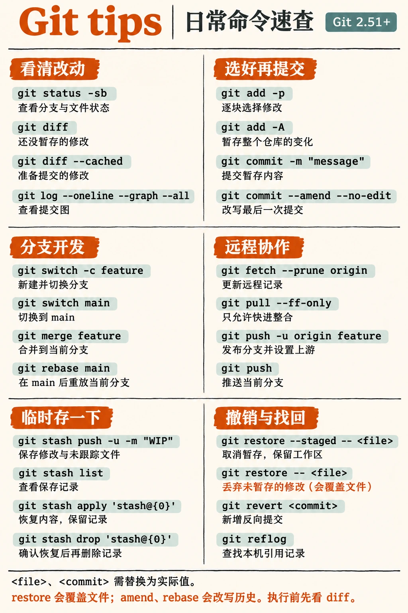

<details>
<summary>36 个 tips，点开直达</summary>

**开工前，把仓库准备好**

- [1. init / clone：新建项目，还是克隆已有项目](#1-init--clone新建项目还是克隆已有项目)
- [2. config：提交之前，先确认身份](#2-config提交之前先确认身份)
- [3. gitignore：不该进仓库的文件，怎么处理](#3-gitignore不该进仓库的文件怎么处理)
- [4. remote：一个本地仓库，可以连接哪些远程](#4-remote一个本地仓库可以连接哪些远程)

**一次本地提交**

- [5. status / diff：提交前，看清自己改了什么](#5-status--diff提交前看清自己改了什么)
- [6. add：一个文件，也能分两次提交](#6-add一个文件也能分两次提交)
- [7. commit：把选好的修改提交下来](#7-commit把选好的修改提交下来)
- [8. amend：刚提交，发现漏了一个文件](#8-amend刚提交发现漏了一个文件)
- [9. log / show：找到想看的那次提交](#9-log--show找到想看的那次提交)

**分支上的工作**

- [10. switch / branch：为新功能创建和整理分支](#10-switch--branch为新功能创建和整理分支)
- [11. detached HEAD：临时查看历史，怎么继续开发](#11-detached-head临时查看历史怎么继续开发)
- [12. diff / log：两个分支，到底差在哪里](#12-diff--log两个分支到底差在哪里)
- [13. merge：把做好的功能合回来](#13-merge把做好的功能合回来)
- [14. rebase：把自己的提交接到主线后面](#14-rebase把自己的提交接到主线后面)
- [15. squash：合入时只留下最终结果](#15-squash合入时只留下最终结果)
- [16. cherry-pick：只拿其中一个修复](#16-cherry-pick只拿其中一个修复)
- [17. 冲突：先解决文件，再继续操作](#17-冲突先解决文件再继续操作)

**与 Agent 并行开发**

- [18. worktree：两个任务，两个工作目录](#18-worktree两个任务两个工作目录)

**与远程协作**

- [19. 远程分支：接着别人的工作继续开发](#19-远程分支接着别人的工作继续开发)
- [20. fetch：先看看远程发生了什么](#20-fetch先看看远程发生了什么)
- [21. pull：双方都有新提交怎么办](#21-pull双方都有新提交怎么办)
- [22. push：把本地提交发出去](#22-push把本地提交发出去)
- [23. push --force-with-lease：rebase 后推送被拒绝，怎么处理](#23-push---force-with-leaserebase-后推送被拒绝怎么处理)
- [24. tag：给发布版本留一个名字](#24-tag给发布版本留一个名字)

**撤销与补救**

- [25. restore --staged：add 多了，怎么取消暂存](#25-restore---stagedadd-多了怎么取消暂存)
- [26. restore：文件改错了，怎么恢复](#26-restore文件改错了怎么恢复)
- [27. stash：没做完的工作，先存一下](#27-stash没做完的工作先存一下)
- [28. reset：退回本地提交，重新组织修改](#28-reset退回本地提交重新组织修改)
- [29. revert：已分享的提交，怎么撤销改动](#29-revert已分享的提交怎么撤销改动)
- [30. 改错分支：先保留成果，再调整位置](#30-改错分支先保留成果再调整位置)
- [31. reflog：提交找不到，先找恢复入口](#31-reflog提交找不到先找恢复入口)
- [32. clean：清理未跟踪文件，先看删除名单](#32-clean清理未跟踪文件先看删除名单)

**整理历史与排查问题**

- [33. rebase -i：把多个提交整理得更好读](#33-rebase--i把多个提交整理得更好读)
- [34. grep / blame：这段代码从哪里来](#34-grep--blame这段代码从哪里来)
- [35. bisect：让 Git 找出引入 bug 的提交](#35-bisect让-git-找出引入-bug-的提交)
- [36. submodule：仓库里面，还有一个仓库](#36-submodule仓库里面还有一个仓库)

</details>

你编辑的是工作区，`add` 选出的内容放进暂存区，`commit` 存到本地仓库，`push` 才会发布到远程。

## 开工前，把仓库准备好

### 1. init / clone：新建项目，还是克隆已有项目

新项目用 `init`，已有项目用 `clone`，两者选一个：

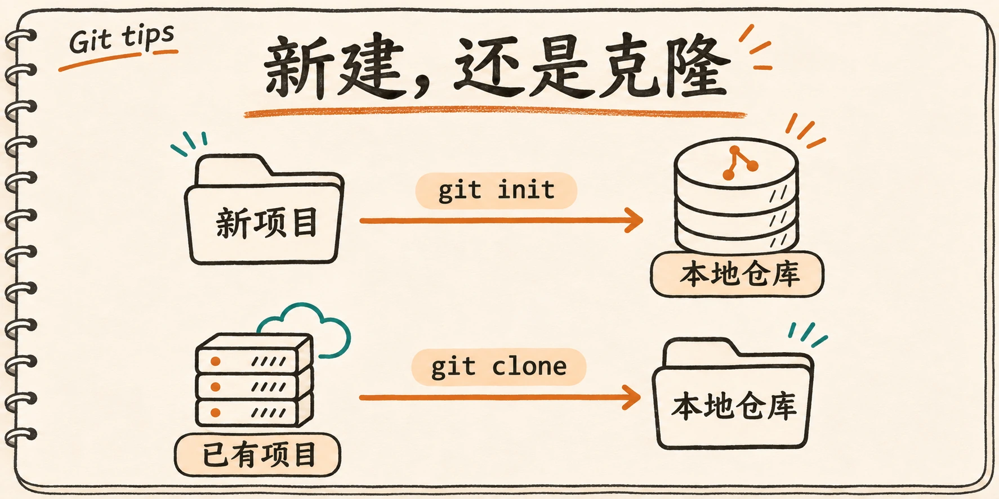

```sh
git init -b main my-project
git clone <url> my-project
```

后续命令都在项目目录里执行。普通开发建议完整克隆；如果只是临时看看某个分支，可以少取一些历史：

```sh
git clone --depth=10 --branch main <url> my-project
# 后来需要完整历史时，再补齐
git fetch --unshallow
```

浅克隆限制的是历史深度，会影响追溯、变基和二分排错，并不是一个解决大文件下载问题的通用开关。

### 2. config：提交之前，先确认身份

提交前设置姓名和邮箱，它们会写入提交记录。

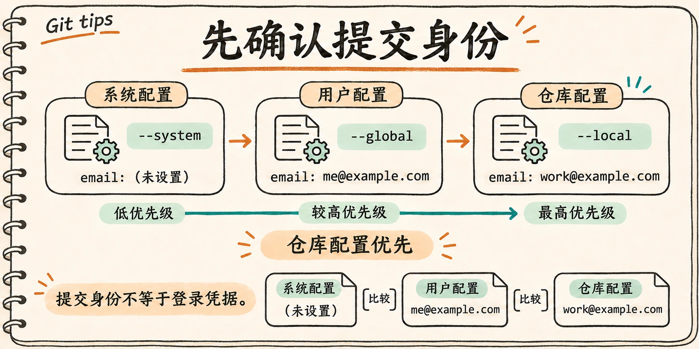

```sh
git config set --global user.name "Your Name"
git config set --global user.email "you@example.com"
# 公司项目单独使用工作邮箱
git config set --local user.email "you@company.example"
git config get user.email
```

常用优先级是 local > global > system。写配置不指定范围时默认写当前仓库，读取时则会合并各层。遇到“明明改了，怎么还没生效”，直接查来源：

```sh
git config list --show-origin --show-scope
# 删除当前仓库的覆盖值
git config unset --local user.email
```

提交身份和远程登录是两回事。改邮箱不能解决 SSH 密钥或 HTTPS 凭据的问题。

### 3. gitignore：不该进仓库的文件，怎么处理

构建产物、日志之类的共同规则，放在仓库的 `.gitignore` 并提交：

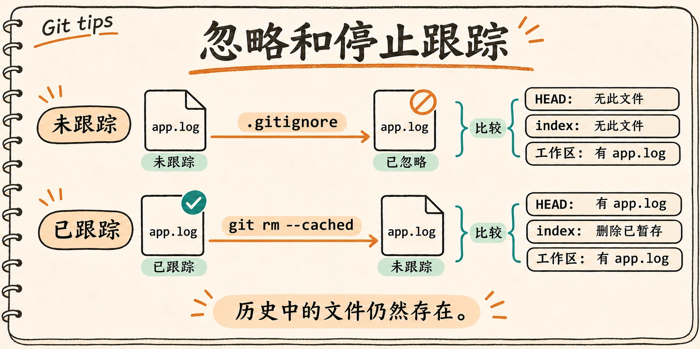

```gitignore
/build/
*.log
!example.log
```

`!` 可以重新包含文件，但被忽略目录里的文件不能单靠这一条救回来，还需要让父目录也能被遍历。同一层最后匹配的规则生效，更深目录的 `.gitignore` 优先；仓库规则又优先于 `.git/info/exclude` 和全局忽略文件。

个人规则放 `.git/info/exclude`，跨项目的个人规则可放 `~/.config/git/ignore`，也可显式指定。找不到哪个规则在生效时，用 `-v`：

```sh
git config set --global core.excludesFile ~/.config/git/ignore
git check-ignore -v -- build/output.txt
```

已经跟踪的文件不会因为新增规则自动退出版本管理。要保留本地文件、停止跟踪，需要提交一次删除：

```sh
git rm --cached -- app.log
git add .gitignore
git commit -m "Stop tracking generated log"
```

`--cached` 保留的是当前本机文件，别人更新这个删除提交时仍会受到影响。历史里已有的内容也还在；如果提交过密钥，先撤换密钥。

### 4. remote：一个本地仓库，可以连接哪些远程

`clone` 通常已经替你配置了 `origin`。要添加第二个仓库、换地址或者删除关联时：

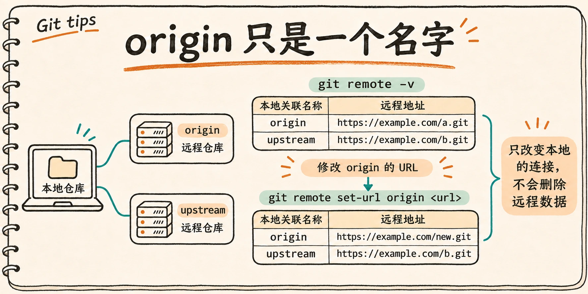

```sh
git remote -v
git remote add upstream <url>
git remote set-url origin <new-url>
git remote rename upstream source
git remote remove source
```

`remote remove` 删除的是本地关联及对应的远程跟踪引用，不会把服务器上的仓库删掉。

## 一次本地提交

### 5. status / diff：提交前，看清自己改了什么

文件名能告诉你改了哪里，diff 才能告诉你改了什么。一个文件暂存后又被编辑，还会同时出现两份修改。

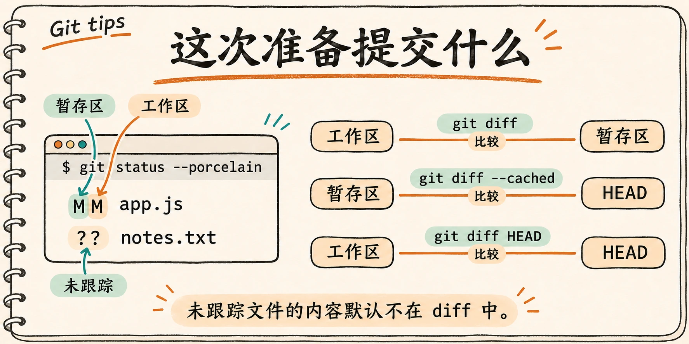

```sh
git status -sb
git diff                 # 工作区与暂存区
git diff --cached        # 暂存区与 HEAD
git diff HEAD            # 工作区与 HEAD
```

`status -s` 简洁显示，`-b` 带分支信息。文件前两列分别表示暂存区、工作区状态，`??` 表示未跟踪。提交前尤其值得看的是 `diff --cached`，它展示准备提交的内容；这些 diff 命令默认不展示未跟踪文件的内容。

遇到冲突或操作中断，用完整的 `git status`，它通常会提示下一步。

### 6. add：一个文件，也能分两次提交

同一文件里有几个不同用途的修改，可以用 `-p` 逐块选择，分开提交：

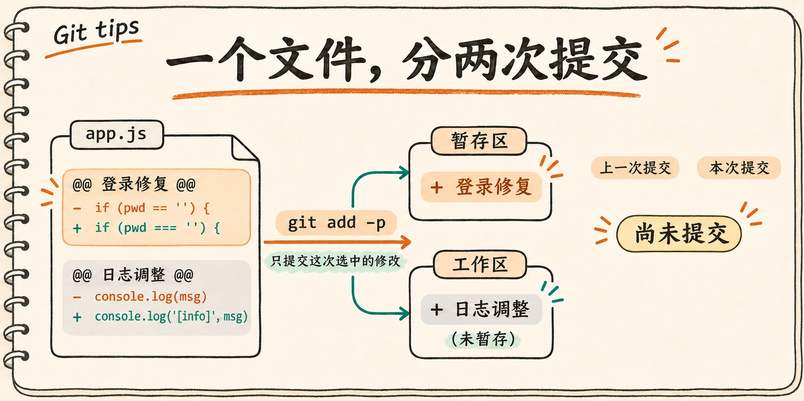

```sh
git add -p
# 也可以指定文件
git add -- README.md
```

交互界面的 `y` 接受当前块，`n` 跳过，`s` 尝试继续拆分，`q` 退出。想一次处理所有变化时，再选下面的写法：

```sh
git add .     # 当前目录及其子目录
git add -A    # 整个仓库，包含新增、修改和删除
git add -u    # 整个仓库，只处理已跟踪文件的修改和删除
```

`add` 保存的是执行那一刻的内容。之后继续编辑的部分，需要再暂存才会进入提交。

重命名和删除也可以明确加入这次提交：

```sh
git mv old-name.txt new-name.txt
git rm -- obsolete.txt
```

`rm` 会检查可能丢失的修改，先看看为什么拒绝，通常不需要直接加 `-f`。

### 7. commit：把选好的修改提交下来

commit 把暂存区的内容保存成一次本地提交。

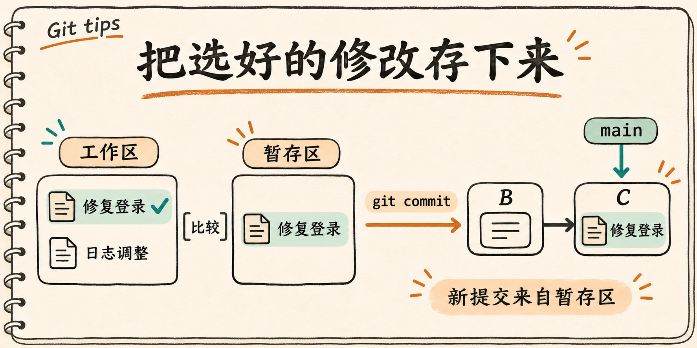

```sh
git commit -m "Fix login redirect"
```

一次提交说清一件事，后面排错、撤销、挑选提交都会省心一些。`git commit -am "message"` 可以顺便暂存已跟踪文件的修改和删除，但不会加入新文件。

还有两个长得很像的参数：`-s` 添加 `Signed-off-by` 贡献声明，`-S` 才是密码学签名。项目要求 signoff 时用 `git commit -s`，不要把两者当成一回事。

### 8. amend：刚提交，发现漏了一个文件

刚提交就发现漏了文件，或者说明没写清楚，可以补改最后一次提交。

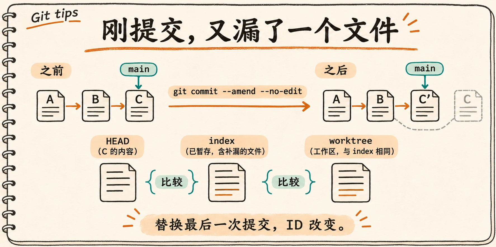

```sh
git add -- <file>
git commit --amend --no-edit
# 需要一起修改说明时，用 git commit --amend
```

amend 用新提交替换分支顶端的提交，ID 会变化；它不会把后续改动自动加入，先 add 需要补交的内容。别人已经依赖的提交，需要先协调，不能只把它当成一次普通补交。

### 9. log / show：找到想看的那次提交

知道大致改了什么、却记不住提交号时，可以从提交图、说明或代码内容找起。

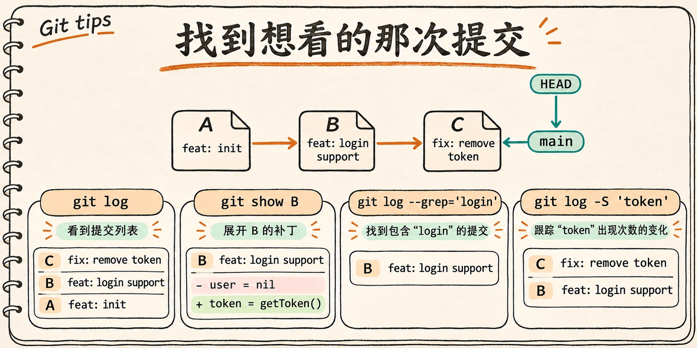

```sh
git log --oneline --decorate --graph --all
git show <commit>
git log --grep="login"
git log -S "functionName" -- src/app.js
git shortlog -sn HEAD
```

`log` 看历史，`show` 看某次提交的说明和补丁。`--grep` 搜索提交说明，`-S` 寻找字符串出现次数变化的提交，适合追踪代码何时加入或删除；`shortlog -sn HEAD` 按提交数汇总贡献者。

分支是指向提交的引用，HEAD 通常指向当前分支。读图时先认清这些名字，比单看一长串提交号容易。

## 分支上的工作

### 10. switch / branch：为新功能创建和整理分支

为新功能建分支，或切回已有分支：

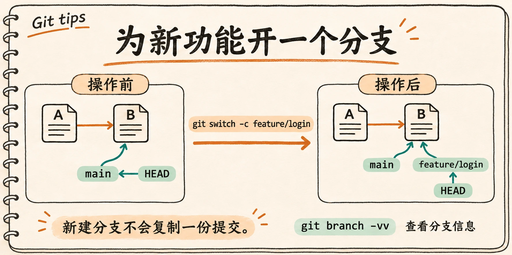

```sh
git switch -c feature/login
git switch main
git switch -
```

分别是创建并切换、切换到已有分支、回到上一个分支。

切换分支不会替你保存修改：能安全携带的修改可能跟过去，会被覆盖时 Git 会拒绝切换。工作还没做完，可以先用 stash 临时保存。

```sh
git branch -vv
git branch -m feature/login feature/sign-in
git branch -d feature/sign-in
```

`-vv` 查看本地分支及上游关系。`-d` 会检查是否已合并到上游；没有上游时检查是否已合并到 HEAD。不能删除当前检出的分支；`-D` 会跳过合并检查，使用前确认提交已保留。

### 11. detached HEAD：临时查看历史，怎么继续开发

临时查看标签或历史提交时，HEAD 可以直接指向提交。此时没有当前分支替你保留新提交的入口。

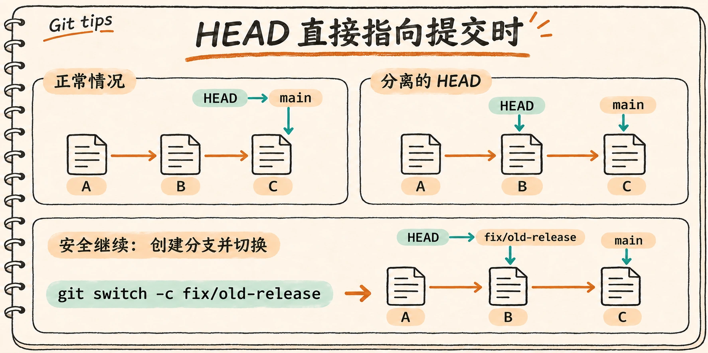

```sh
git switch --detach v1.0.0
# 准备在这个版本上继续开发，先建分支
git switch -c fix/old-release
```

游离状态也能提交，但直接离开后容易丢失入口。创建分支后，HEAD 重新通过分支指向提交，原来的 main 不会因此退回旧版本。

### 12. diff / log：两个分支，到底差在哪里

想看功能分支带来了什么，先确定自己要比较文件快照，还是筛选提交。下面都从同一个分叉历史出发。

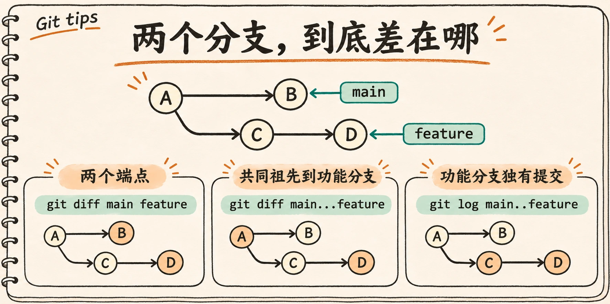

```sh
git diff main feature/login       # 两个端点的快照差异
git diff main...feature/login     # 共同祖先到 feature/login 的变化
git log --oneline main..feature/login  # 功能分支独有的提交
```

`diff A B` 与 `diff A..B` 比较两个端点，`diff A...B` 比较共同祖先与 B，有方向性。`log A..B` 选择从 B 可达、从 A 不可达的提交；`log A...B` 选择双方独有的提交。

对于线性历史 `P—A—B—C`，`A..C` 是 B、C，`A^..C` 还包含 A，前提是 A 有父提交。范围按可达关系选择，不是按日期截取。

### 13. merge：把做好的功能合回来

功能完成后，切回 main 再合并：

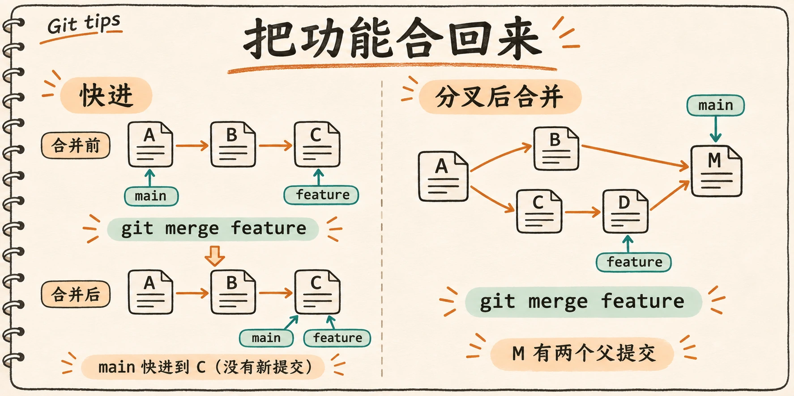

```sh
git switch main
git merge feature/login
```

方向别弄反：这是把 `feature/login` 合入当前的 `main`。如果 main 没有独立的新提交，通常可以快进，只移动分支引用；双方都有新提交时，通常会生成一个有两个父提交的 merge commit。

需要保留明确的合并节点时，可以用 `git merge --no-ff feature/login`。

### 14. rebase：把自己的提交接到主线后面

功能还没发布，主线已经往前走了，可以在自己的分支上重放提交：

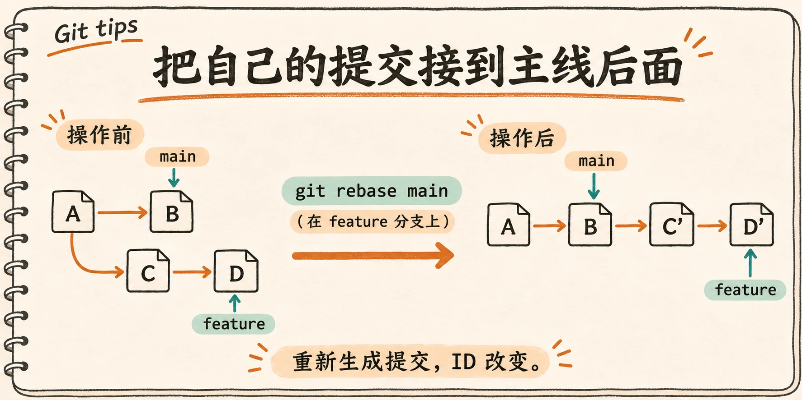

```sh
git switch feature/login
git rebase main
```

完成后，功能提交接在 main 后面，提交 ID 通常会变化。它适合整理自己的分支；别人已经依赖的历史，需要先协调。`main` 也需要先更新，rebase 不会自动替你获取服务器上的最新代码。

### 15. squash：合入时只留下最终结果

功能分支上有很多调试、修补提交，合入主线时只想留下最终结果：

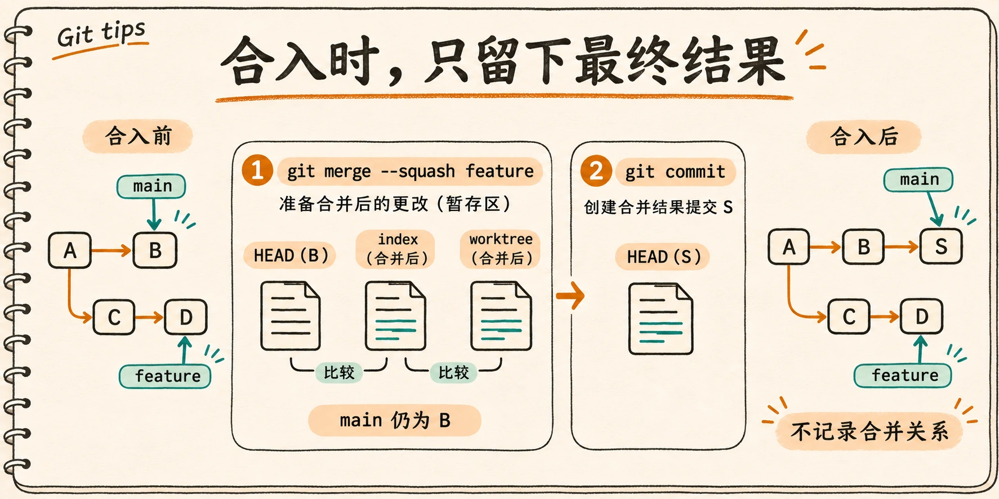

```sh
git switch main
git merge --squash feature/login
git diff --cached
git commit -m "Add login page"
```

别漏掉最后的 `commit`。`--squash` 只准备工作区和暂存区，不会直接创建提交，也不记录原分支的双亲合并关系。因此 Git 不会仅凭历史认定原功能分支已经合并，后续继续整合它时要留意这一点。

### 16. cherry-pick：只拿其中一个修复

另一个分支上有一个修复，当前分支也需要，但不想把整个分支都合进来：

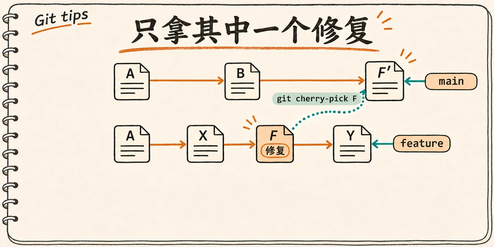

```sh
git cherry-pick <commit>
# 多个指定提交，按列出的顺序应用
git cherry-pick <commit1> <commit2>
```

需要挑选一段线性历史时，先检查范围再执行：

```sh
git log --reverse --oneline <A>..<C>
git cherry-pick <A>..<C>
```

这里排除 A、包含 C；分叉历史按可达关系选择，具体比较方法见前面的分支比较。挑选通常会生成新提交，而不是移动原来的提交。

### 17. 冲突：先解决文件，再继续操作

先 `git status` 确认正在 merge、rebase 还是 cherry-pick，再处理文件中的冲突标记。检查结果并暂存后，选择对应的命令继续：

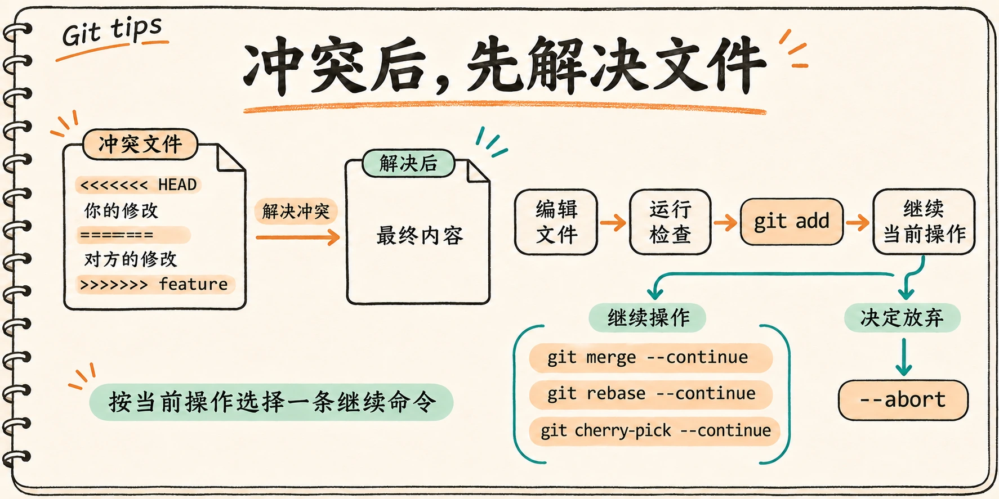

```sh
git add -- <resolved-file>
# 按当前操作选一条
git merge --continue
git rebase --continue
git cherry-pick --continue
```

决定放弃本次操作时，用对应的 `--abort`。开始合并前尽量保持工作区干净，有未提交修改时，中止操作也不保证能完整还原原状。

## 与 Agent 并行开发

### 18. worktree：两个任务，两个工作目录

你在一个目录开发功能，Agent 在另一个目录修 bug，各自保留未提交的修改。先确认起点 `main` 已更新，再创建新分支和工作目录：

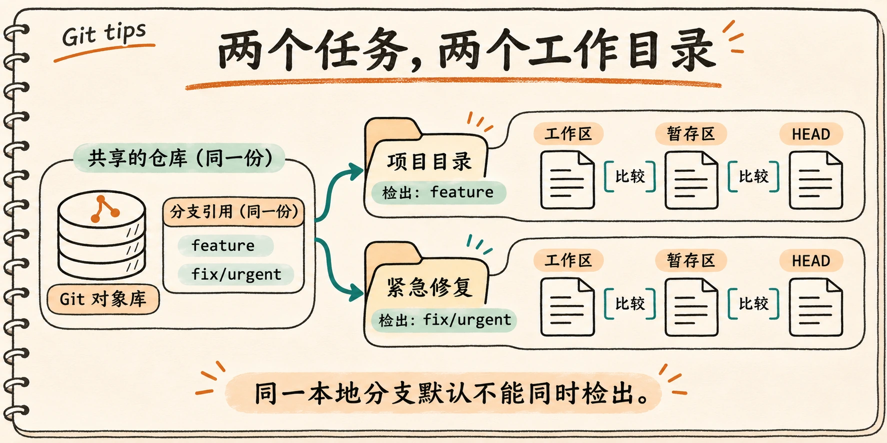

```sh
git worktree add -b fix/urgent ../project-urgent main
git worktree list
# 明确指定在哪个目录执行，不必来回 cd
git -C ../project-urgent status -sb
```

每个目录有独立的工作区、暂存区和 HEAD，共享对象、分支引用及大部分配置。同一本地分支默认不能同时在两个 worktree 检出，所以给每个并行任务单独建分支。

分配任务时写清目录、分支、起点和允许修改的范围，让 Agent 在指定目录里执行命令。worktree 只分开 Git 工作目录；服务端口、外部数据库和目录之外的文件仍可能互相影响。依赖和本地环境文件也需要按项目要求准备。

普通仓库配置与 stash 列表默认共享。在一个目录执行 `git config --local` 或删除 stash，也可能影响另一个任务。

#### 检查任务目录和提交内容

人工查看用 `status -sb`；脚本读取状态时，用格式稳定的 porcelain 输出。`-z` 用 NUL 分隔记录，文件名带空格或换行时也能区分，解析时不要按行拆，重命名记录还会包含两个路径：

```sh
git -C ../project-urgent rev-parse --show-toplevel
git -C ../project-urgent branch --show-current
git -C ../project-urgent status --porcelain=v1 -z
```

`branch --show-current` 在 detached HEAD 下输出为空。让 Agent 写入前先核对目录和分支；普通任务应在分配好的分支上继续。

提交前检查暂存内容，完成后再从主目录审查整个任务分支：

```sh
# 在任务目录中，先明确选择文件，再检查准备提交的内容
git -C ../project-urgent add -- <file>
git -C ../project-urgent diff --cached --check
git -C ../project-urgent diff --cached
git -C ../project-urgent commit -m "Fix urgent issue"
# 回到主目录审查已提交的成果
git log --oneline main..fix/urgent
git diff --stat main...fix/urgent
git diff main...fix/urgent
```

`diff --check` 检查空白错误和新增的冲突标记，不能代替代码审查与项目测试。分支比较只包含已提交的成果，接手前还要确认任务目录中没有遗漏的修改和新文件。

#### 合入成果，再清理目录

让 Agent 停止写入并完成测试，再按项目流程提交 PR，或在干净的本地 `main` 上合并：

```sh
git switch main
git merge --ff-only fix/urgent
# 确认成果已保留、任务目录不再使用后清理
git worktree remove ../project-urgent
git branch -d fix/urgent
```

这里的快进合并在主线已分叉时会停止。此时按[merge](#13-merge把做好的功能合回来)或[rebase](#14-rebase把自己的提交接到主线后面)的流程整合；只取一个修复则用[cherry-pick](#16-cherry-pick只拿其中一个修复)。[分支比较](#12-diff--log两个分支到底差在哪里)、[冲突处理](#17-冲突先解决文件再继续操作)也沿用前面的做法。

`worktree remove` 会检查未提交内容，保留分支；`branch -d` 再检查合并情况。squash 或 cherry-pick 后，Git 可能仍认为原分支未合并，先核对成果，不要直接换成强制删除。若目录已经被手动移走或删除，用 `git worktree prune --dry-run` 查看失效记录，再用 `git worktree prune` 清理。

<details>
<summary>建立独立历史的工作目录</summary>

需要完全没有父提交的独立历史，例如单独发布文档时，可以创建一个空的新工作目录：

```sh
git worktree add --orphan -b site ../project-site
```

目录初始没有已跟踪文件，首次提交会成为新的根提交。

</details>

## 与远程协作

### 19. 远程分支：接着别人的工作继续开发

同事已经把功能分支推到服务器，本地却还没有这个分支。先获取远程记录，再创建自己的本地分支。

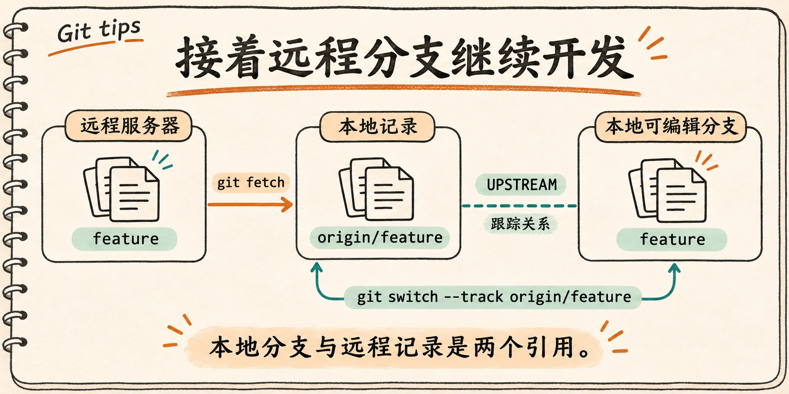

```sh
git fetch origin
git switch --track origin/feature/login
```

这会创建本地 `feature/login`，并把 `origin/feature/login` 设为它的上游。两者是不同的引用：本地提交会移动本地分支，fetch 更新远程跟踪引用。

本地分支已经存在、只想修改上游时，单独执行：

```sh
git branch --set-upstream-to=origin/feature/login feature/login
git branch -vv
```

上游关系为默认 pull 和 ahead/behind 提示提供依据，不表示服务器会自动接收本地的新提交。

### 20. fetch：先看看远程发生了什么

fetch 后 origin/main 从 B 更新到 C，本地 main 仍在 B，工作区不变。

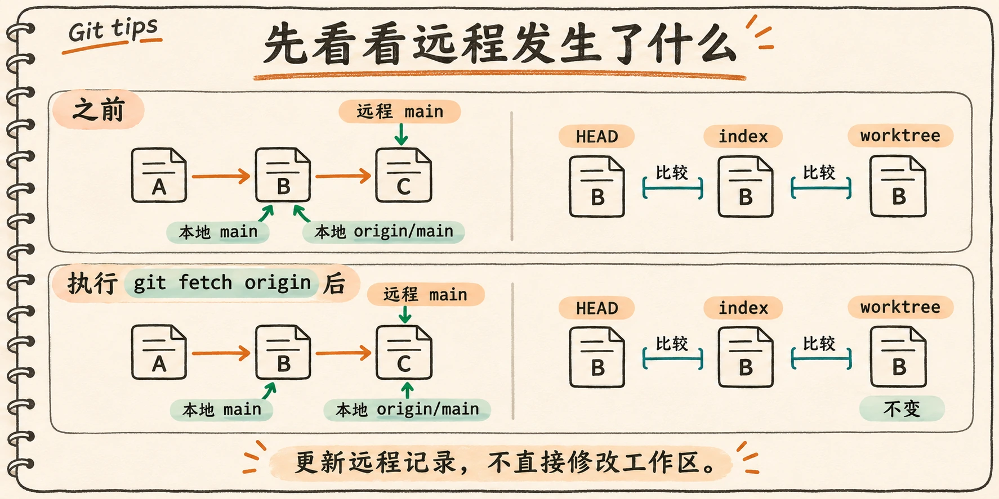

```sh
git fetch --prune origin
git log --oneline HEAD..origin/main
```

`fetch` 获取对象和远程跟踪引用，不直接改变当前分支、暂存区和工作区。`origin/main` 是本机保存的远程记录，不是服务器的实时状态。

默认的分支配置下，`--prune` 还会清理远程已删除分支的跟踪引用，不删除你的本地开发分支，也不清理标签。配置过自定义 refspec 时，先确认清理范围。

### 21. pull：双方都有新提交怎么办

上游已配置时，日常更新推荐明确加上快进限制：

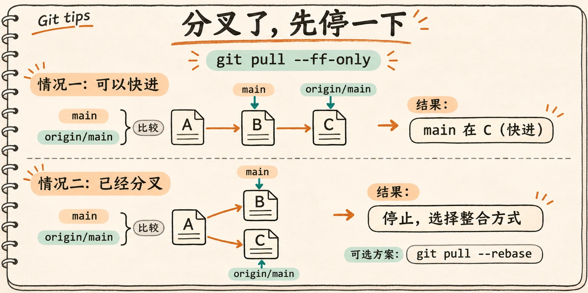

```sh
git pull --ff-only
```

它获取更新后只允许快进。双方各自有新提交时，命令会停止，让你选择如何整合。若明确要重放自己的本地提交，再用 `git pull --rebase`。

想把获取和整合拆开看，也可以：

```sh
git fetch origin
git switch main
git merge --ff-only origin/main
```

### 22. push：把本地提交发出去

功能在本地做完了，第一次发布时可以顺手建立上游。

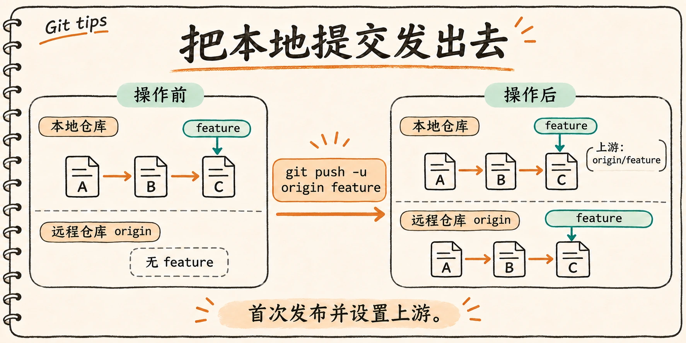

```sh
git push -u origin feature/login
# 上游建立后，在该分支继续推送
git push
# 功能已合并，删除远程分支
git push origin --delete feature/login
```

`-u` 建立上游关系，后续默认推拉和 ahead/behind 提示都会用到它。推送被拒绝时，先 fetch 看看差异，不要立刻加 `--force`。

### 23. push --force-with-lease：rebase 后推送被拒绝，怎么处理

自己的已发布分支经过 rebase 或 amend，常规推送可能因不再快进而拒绝。推送前要检查远程变化，确认团队允许改写这段历史。

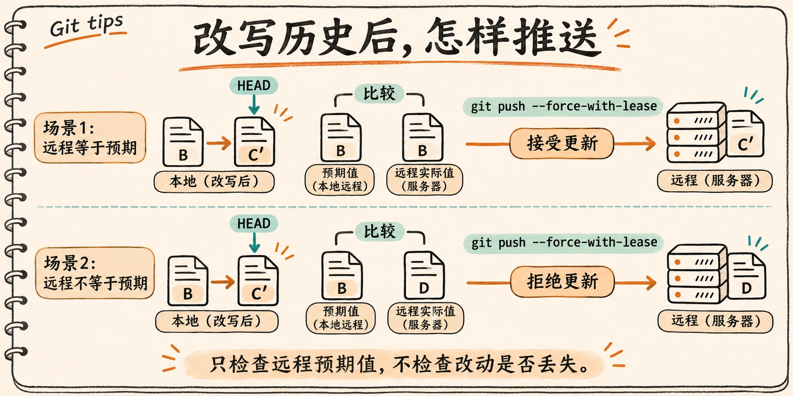

先确认团队允许，并检查远程已有的工作是否保留，再锁定你审查过的版本：

```sh
git fetch origin
git log --oneline --left-right HEAD...origin/feature/login
expected=$(git rev-parse refs/remotes/origin/feature/login)
git push --force-with-lease=refs/heads/feature/login:"$expected" origin HEAD:refs/heads/feature/login
```

只有远程仍指向 `expected` 时才接受更新。不带预期值的 lease 依赖远程跟踪引用，后台 fetch 可能削弱保护。显式预期值也只检查远程有没有变化，不检查你的新历史是否丢失改动，仍需要审查和协作。

### 24. tag：给发布版本留一个名字

准备发布一个版本，就给这次提交留个名字，方便以后再找到它。

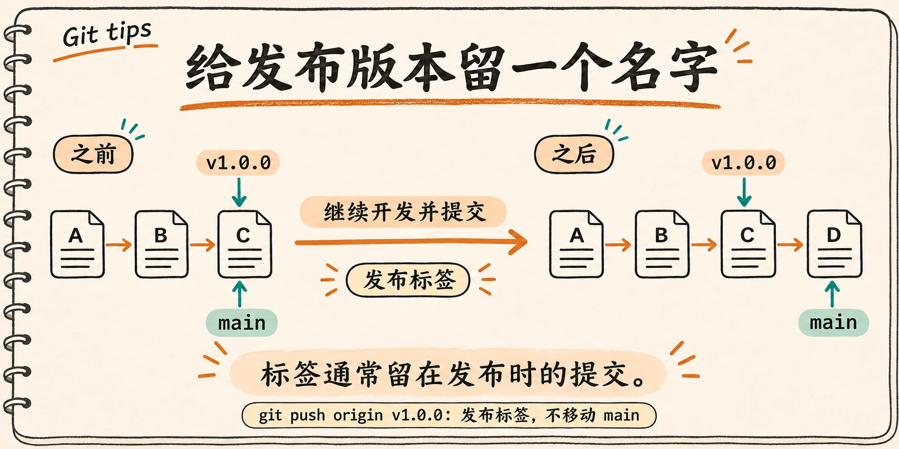

```sh
git tag -a v1.0.0 -m "Release 1.0.0"
git push origin v1.0.0
```

分支会随提交向前走，标签通常留在发布时的提交上。普通分支推送不会顺便发布所有标签，建议明确推送需要的标签。

误建标签时，本地和远程需要分别删除；已经对外发布的标签通常不应重写：

```sh
git tag -d v1.0.0
git push origin --delete tag v1.0.0
```

## 撤销与补救

### 25. restore --staged：add 多了，怎么取消暂存

文件 add 多了，只想重新选择提交内容，不需要把工作区修改一起撤掉。

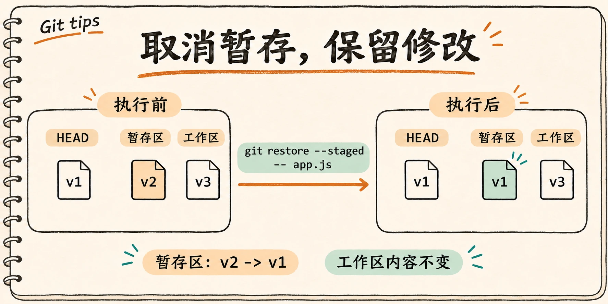

```sh
git restore --staged -- README.md
```

默认从 HEAD 恢复暂存区，工作区保持原样。一个新文件取消暂存后可能回到未跟踪状态，文件仍留在本地。

仓库还没有首次提交时不存在 HEAD，新加文件可用 `git rm --cached -- <file>` 取消跟踪并保留工作区。

### 26. restore：文件改错了，怎么恢复

确定不需要某文件未暂存的修改时，可以从暂存区覆盖工作区。先看 diff，再执行。

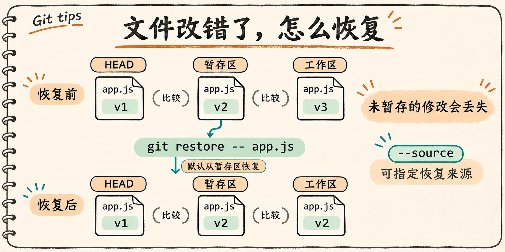

```sh
git diff -- README.md
git restore -- README.md
```

默认来源是暂存区，不一定是最后一次提交。Git 通常救不回从未暂存或提交的文本，覆盖前先保存仍需要的内容。这里的 `--` 把文件路径与选项分开。

想从指定提交取回文件，默认只改工作区，确认后仍需 add、commit：

```sh
git restore --source=<commit> -- README.md
# 以下会丢弃该文件所有未提交修改，同时覆盖暂存区与工作区
git restore --source=HEAD --staged --worktree -- README.md
```

### 27. stash：没做完的工作，先存一下

临时切去修 bug，又不想提交半成品：

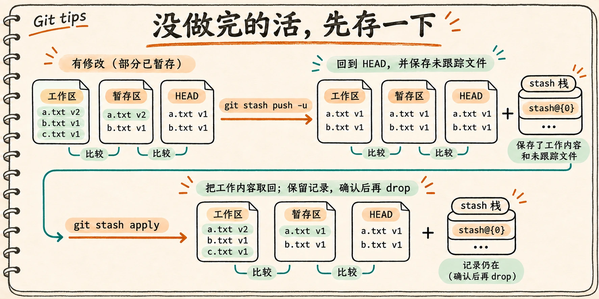

```sh
git stash push -u -m "WIP: login form"
git stash list
git stash show -p --include-untracked 'stash@{0}'
git stash apply 'stash@{0}'
# 确认恢复正确后再删除记录
git stash drop 'stash@{0}'
```

默认保存已跟踪文件的修改，`-u` 额外包含未跟踪文件，仍不包含忽略文件。`apply` 保留记录，`pop` 在成功恢复后移除；发生冲突时 pop 会保留记录。需要尝试还原暂存状态时，用 `apply --index`。

`--keep-index` 适合把暂存内容留下单独测试，但 stash 仍会记录这部分内容。stash 冲突没有专用的 `--continue`，处理好文件后正常暂存、提交即可。不要在确认恢复前清空记录。

<details>
<summary>换台电脑继续做：传递 stash</summary>

stash 不会随普通分支推送自动传递，可以导出选定记录，用一个专用的新分支传输：

```sh
# 发送端
git stash export --to-ref refs/heads/wip-transfer 'stash@{0}'
git push origin refs/heads/wip-transfer
# 接收端
git fetch origin refs/heads/wip-transfer
git stash import FETCH_HEAD
```

导出会更新指定引用，不要用正常开发分支的名字。导入会追加本机 stash 记录；内容可能包含未跟踪文件，推送前检查是否适合分享。

</details>

### 28. reset：退回本地提交，重新组织修改

想退回自己的本地提交，重新选择内容或调整提交方式时，用 reset。它没有被 restore 替代：这里要调整的是提交位置。

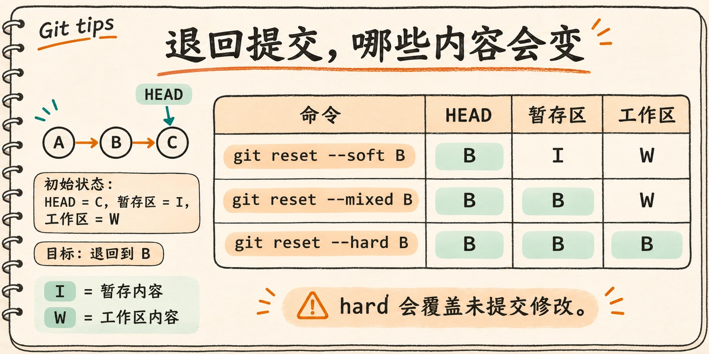

假设已经有提交，且没有未解决的冲突：

| 命令 | 当前分支 | 暂存区 | 工作区 |
|---|---|---|---|
| `git reset --soft <commit>` | 移到目标提交 | 不变 | 不变 |
| `git reset --mixed <commit>` | 移到目标提交 | 恢复成目标快照 | 不变 |
| `git reset --hard <commit>` | 移到目标提交 | 恢复成目标快照 | 覆盖为目标快照 |

保留修改并重新组织提交时，通常选 soft 或默认的 mixed。hard 还会丢弃工作区修改，别把它当作普通的“更新代码”。

`--hard` 不会普遍删除所有未跟踪文件，但会删除阻碍写入目标文件的未跟踪文件或目录。共享历史通常用 revert，reset 适合明确允许重写的本地历史。detached HEAD 下移动的是 HEAD 本身。

### 29. revert：已分享的提交，怎么撤销改动

提交已经被别人拉走，通常用一个新的反向提交撤销改动：

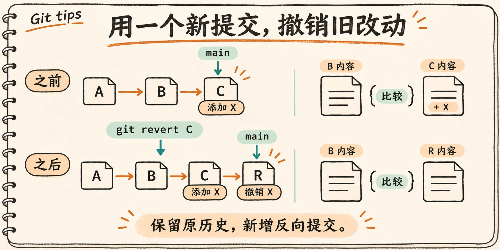

```sh
git revert <commit>
```

需要把线性历史 `A..C` 中的 B、C 一起撤销成一个提交时：

```sh
git revert --no-commit <A>..<C>
git diff --cached
git commit -m "Revert the selected changes"
```

这里用两点范围。三点表示双方独有提交，不能用它表达“排除 A、包含 C”。冲突解决并 add 后用 `git revert --continue`，放弃则用 `git revert --abort`。

merge commit 还需要选择主线，例如 `git revert -m 1 <merge-commit>` 会反向应用相对第一个父提交的变化。合并关系仍在，之后再合并原分支不会简单重放已撤销的祖先提交，操作前先确认意图。

### 30. 改错分支：先保留成果，再调整位置

本来准备做一个新功能，却直接在 main 上改起来了。先判断有没有提交，以及提交是否已经被别人依赖。

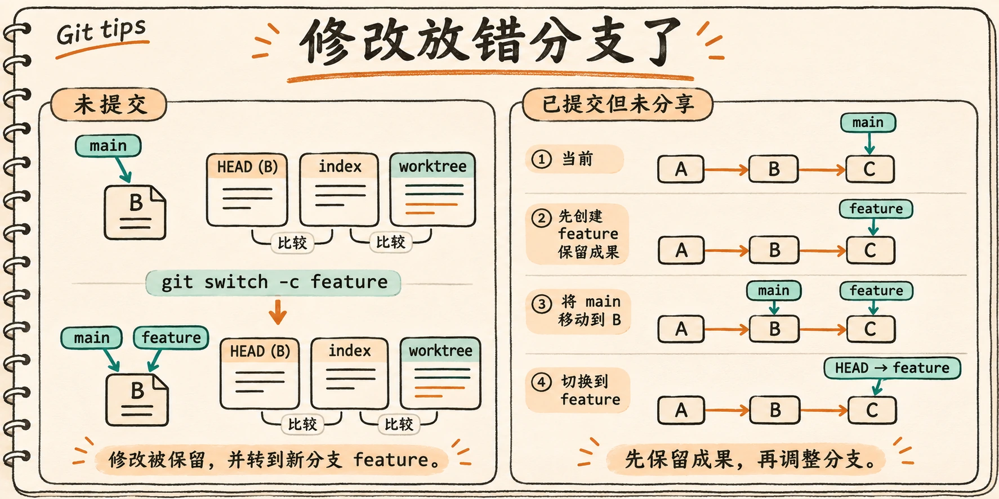

还没提交、需要创建新分支时，可以把修改带到新分支：

```sh
git switch -c feature/login
```

如果刚在 main 上提交了一次，**尚未分享、工作区和暂存区干净，并且 HEAD 有父提交**，可以先建立保留提交的分支，再把 main 退回去：

```sh
git status
git branch feature/login
git reset --keep HEAD~1
git switch feature/login
```

这里假设新分支名还不存在。`--keep` 遇到会覆盖的本地修改会拒绝；不要为绕过检查直接换成 hard。多次提交要先核对退回位置，已共享的 main 则需要协调，通常通过 revert 撤销改动，不应直接改写共享历史。

### 31. reflog：提交找不到，先找恢复入口

误 reset 或删分支后，先找旧提交，再建一个救援分支，不必立刻再次覆盖工作区：

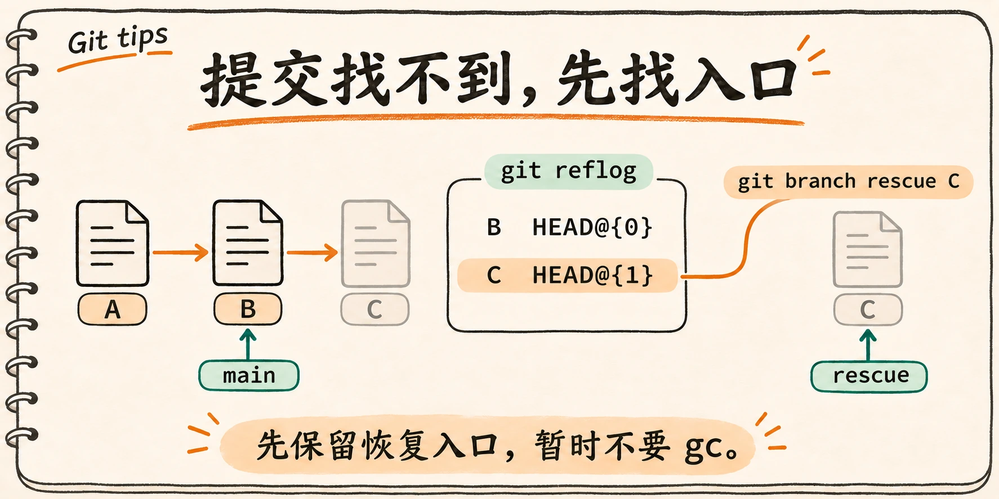

```sh
git reflog --date=local
git show <lost-commit>
git branch rescue/lost-work <lost-commit>
```

reflog 记录本机引用变化，不随 push 分享，也不永久保留。找到的提交尚未被清理时，这个分支就能替你保留入口。

<details>
<summary>reflog 找不到，或者误删了 stash</summary>

先停止清理，复制整个仓库作为现场备份。要包含 `.git`，linked worktree 还要备份它指向的公共 Git 目录；普通 clone 不会完整复制不可达对象。

```sh
git fsck --full --no-reflogs --unreachable
git show <candidate-commit>
git branch rescue/recovered <candidate-commit>
```

输出里有些只是正常旧对象，逐个确认内容。若找到误删的 stash commit，用 `git stash apply <stash-commit>` 恢复；创建分支或 cherry-pick 不一定能还原暂存区和未跟踪文件。

Git 平时会自动做部分维护，一般不必手动运行 `git gc`。gc 会压缩对象，并按过期策略清理部分不可达对象；恢复期间不要运行它，尤其不要使用 `--prune=now`。对象已清理，或文本从未保存到 Git，都无法保证恢复。

</details>

### 32. clean：清理未跟踪文件，先看删除名单

清理临时文件时，先把范围限定在需要清理的目录并预览：

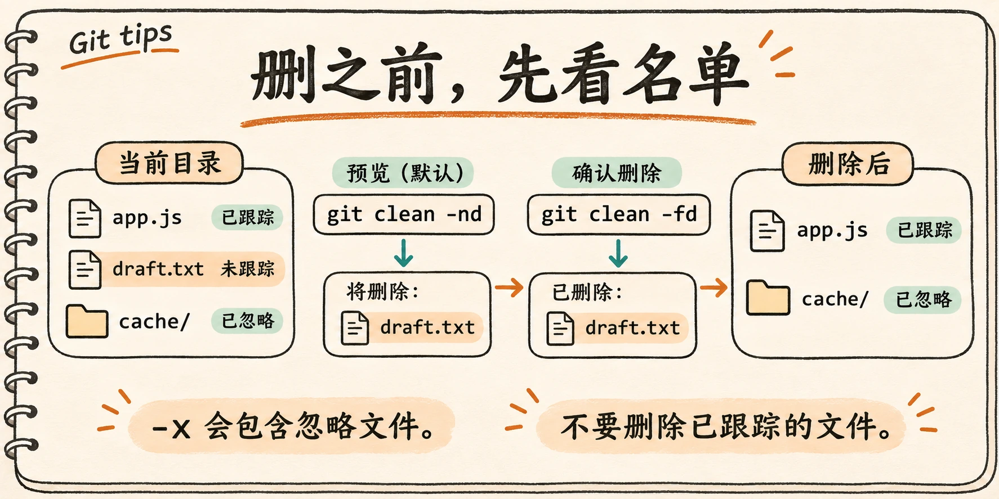

```sh
git clean -nd -- build/    # 预览
git clean -fd -- build/    # 确认后删除
```

`-d` 包含未跟踪目录，默认遵守忽略规则。需要连被忽略的文件也纳入范围时，先用 `git clean -ndx` 看清名单，再决定是否执行对应删除命令。两次执行之间文件若有变化，删除范围也会变。

缓存里也可能有还没备份的本地数据，别养成顺手执行 `reset --hard` 加 `clean` 的习惯。未跟踪文件通常无法从 reflog 找回。

## 整理历史与排查问题

### 33. rebase -i：把多个提交整理得更好读

多个本地提交准备分享前，可以先把说明和内容整理到便于阅读的程度。以下示例要求 `HEAD~3` 存在，且这些提交允许重写。

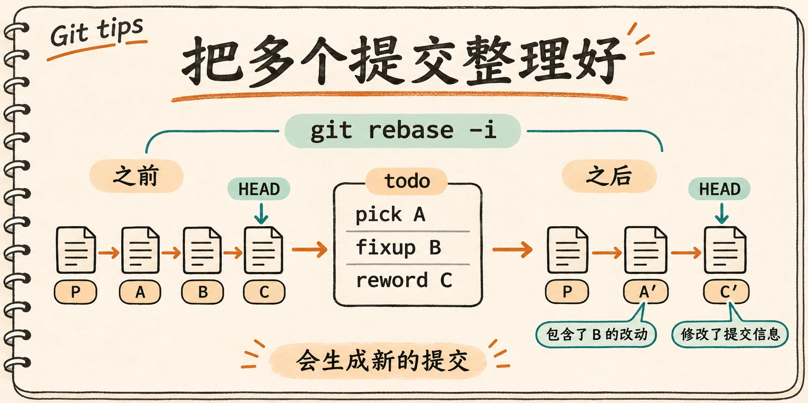

整理最近三个提交：

```sh
git branch backup/before-rebase
git rebase -i HEAD~3
```

编辑器中从旧到新排列：`pick` 保留，`reword` 改说明，`squash` 合到前一条并编辑说明，`fixup` 合到前一条但丢弃本条说明，`drop` 丢弃。确认每个提交的去留，尤其别误删仍需保留的改动。

换基点时可用 `git rebase --onto main old-base topic`：选择 topic 中不属于 old-base 历史的提交，在 main 后重放，并更新 topic。合并、重复补丁和空提交还会受到 rebase 处理规则影响，不是简单按两个端点复制。

<details>
<summary>把一个小修复自动合回之前的提交</summary>

已暂存的小修复可以标记给某个提交，再用 autosquash 排到对应位置。这里要求目标提交有父提交，且整段历史允许重写：

```sh
git commit --fixup=<commit>
git rebase -i --autosquash <commit>^
```

在 todo 列表里确认安排后再继续；发生冲突时仍需手动处理。

</details>

### 34. grep / blame：这段代码从哪里来

查一段代码的来历，可以先定位文件和行号，再查看相关提交：

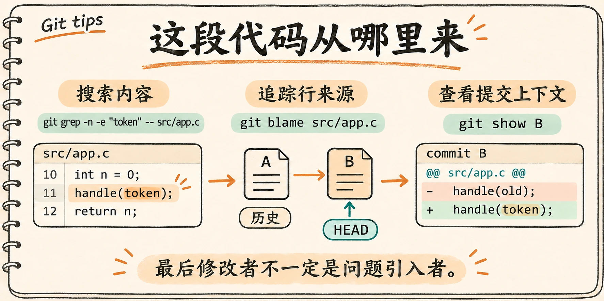

```sh
git grep -n -e "TODO" -- src/
git grep -n -e "oldFunction" <commit> -- src/
git blame -L 10,30 -- src/app.js
git log -p -- src/app.js
```

`grep` 默认搜索已跟踪文件，也能查历史提交；`blame` 显示每行最后一次相关修改。别只看作者姓名就下结论，跟进提交补丁和上下文，才能知道当时为什么那样改。

### 35. bisect：让 Git 找出引入 bug 的提交

已知一个正常版本和一个错误版本，Git 可以逐步检出中间版本，你只需测试并反馈好坏：

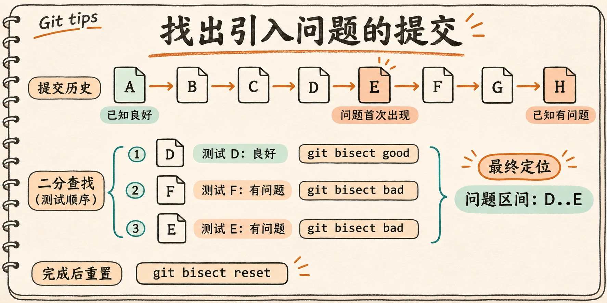

```sh
git bisect start
git bisect bad <bad-commit>
git bisect good <good-commit>
# 每次测试后，根据结果选一条
git bisect good
git bisect bad
# 当前版本无法测试时
git bisect skip
# 找到问题或决定停止后，回到开始前的位置
git bisect reset
```

工作区先保持干净。检查可以自动化时，用 `git bisect run ./test-regression.sh`：返回 0 表示正常，1～127（125 除外）表示错误，125 表示跳过，其他返回值中止查找。注意测试程序是否真的在检测这个 bug，别把缺少构建工具当成代码有问题。

### 36. submodule：仓库里面，还有一个仓库

主仓库记录子模块的提交 ID 和 `.gitmodules` 配置。克隆时一次取全，或者在已有仓库里补初始化：

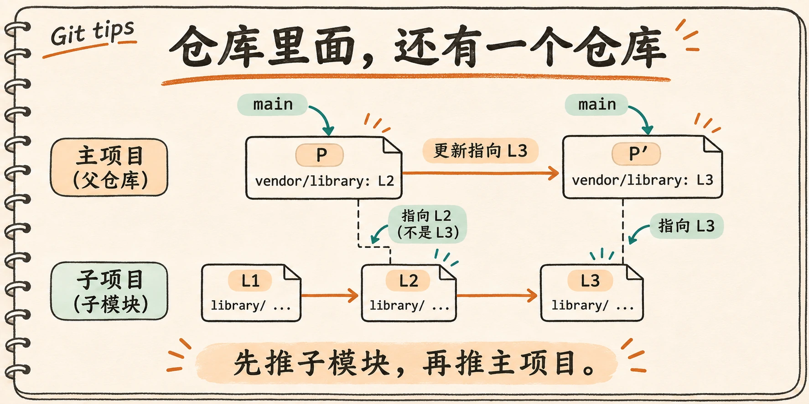

```sh
git clone --recurse-submodules <url> project
git submodule update --init --recursive
# 添加新子模块
git submodule add <library-url> vendor/library
git commit -m "Add library submodule"
```

修改子模块时，先在里面创建分支、提交并推送，再回主仓库记录新指针：

```sh
git add -- vendor/library
git commit -m "Update library revision"
```

默认 update 常把子模块放在 detached HEAD。需要的通常是主项目记录的固定版本；加 `--remote` 会改为按远程分支更新，主项目仍要提交指针变化。先推子模块，再推主项目，避免别人拿到一个无法获取的提交 ID。

## 顺手的 alias

正文和速查图写完整命令，日常操作可以用熟悉的缩写。Git alias 以 `git sw main` 这样的形式调用：

```sh
git config set --global alias.sw switch
git config set --global alias.swc "switch -c"
git config set --global alias.unstage "restore --staged"
```

`--global` 对当前用户生效，只想在本仓库试用就改用 `--local`。删除某项用 `git config unset --global alias.sw`。下面的配置按需合入用户 Git 配置的 `[alias]` 段，保留文件里的其他内容；不要直接粘贴到 shell 执行。

原版缩写全部保留，强制操作和批量操作放在后面的可选配置里。几处写法有调整，迁移时留意：

| alias | 处理方式与用法 |
|---|---|
| `sti` | 修正为 `status --ignored --show-stash`，原来的命令和参数都有拼写错误。 |
| `pl` | 改为 `pull --ff-only`，双方分叉时停止；明确要变基时仍用 `plr`。 |
| `shsa`、`shsak` | 改用 `stash push -m` 和 `stash push --keep-index -m`，例如 `git shsa "WIP: login"`；说明里有空格要加引号。 |
| `cfl`、`cfgl`、`cfsl` | 改用 `config list` 子命令，作用域不变。 |
| `cmm`、`cmme`、`cma`、`cman` | 保留原来的 `-s`，会添加 Signed-off-by，适用于项目要求贡献声明的场合。普通提交用 `cm`；这些别名不会自动暂存文件。 |
| `co`、`cob`、`coo` | 保留 checkout 用法；切换分支也可用 `sw`、`swc`。`coo` 保留 checkout 创建 orphan 分支时的文件行为。 |
| `rse` | 保留 `reset HEAD`，默认取消全部暂存；`unstage` 使用 `restore --staged`，需传文件路径或 `.`。 |
| `lgga` | 恢复彩色图、作者和相对时间格式；需要看全部分支时加 `--all`。 |

`aa` 暂存整个仓库，`au` 只暂存已跟踪文件的修改和删除。`ae` 手工编辑补丁，`ap` 逐块选择。`clb` 后接分支名和地址，`cld` 后接深度和地址，例如 `git cld 10 <url>`。`sl`、`slsn` 后加 `HEAD` 查看当前历史，避免无参数时等待标准输入。`cfg`、`cfs` 保留旧式配置语法，设置时分别影响用户和系统范围。

```gitconfig
[alias]

    # 建仓库与配置
    it = init
    cl = clone
    clb = clone --single-branch --branch
    cld = clone --depth
    cf = config
    cfl = config list
    cfg = config --global
    cfgl = config list --global
    cfs = config --system
    cfsl = config list --system

    # 查看状态、差异和历史
    st = status --show-stash
    sti = status --ignored --show-stash
    df = diff
    dfc = diff --cached
    dfh = diff HEAD
    lg = log
    lgo = log --oneline
    lgga = log --graph --pretty=format:'%Cred%h%Creset -%C(yellow)%d%Creset %s %Cgreen(%cr) %C(bold blue)<%an>%Creset' --abbrev-commit --date=relative
    lgge = log --grep
    lgs = log -S
    so = show
    sl = shortlog
    slsn = shortlog -s -n
    ge = grep -n
    gec = grep -c
    bm = blame
    rf = reflog
    fc = fsck

    # 选择文件与提交
    a = add
    aa = add -A
    au = add -u
    ae = add -e
    ap = add -p
    cm = commit
    cmm = commit -s -m
    cmme = commit -s --allow-empty -m
    cma = commit -s --amend
    cman = commit -s --amend --no-edit
    rmc = rm --cached

    # 分支与整合
    br = branch -vv
    bra = branch -a
    brm = branch -m
    co = checkout
    cob = checkout -b
    coo = checkout --orphan
    me = merge
    mea = merge --abort
    mec = merge --continue
    men = merge --no-ff
    rb = rebase
    rba = rebase --abort
    rbc = rebase --continue
    rbi = rebase -i
    rbo = rebase --onto
    cp = cherry-pick
    cpa = cherry-pick --abort
    cpc = cherry-pick --continue

    # 远程与标签
    rt = remote
    rta = remote add
    rtp = remote prune
    rtpd = remote prune --dry-run
    rtrm = remote remove
    rtrn = remote rename
    rtsu = remote set-url
    rtsua = remote set-url --add
    rtsud = remote set-url --delete
    rts = remote show
    rtu = remote update
    rtv = remote -v
    fh = fetch
    fha = fetch --all
    pl = pull --ff-only
    plr = pull --rebase
    ps = push
    psu = push -u
    tg = tag
    tga = tag -a
    tgd = tag -d

    # 临时保存、撤销与排错
    sh = stash
    shu = stash -u
    shk = stash --keep-index
    sha = stash apply
    shd = stash drop
    shl = stash list
    shp = stash pop
    shsh = stash show
    shshp = stash show -p
    shsa = stash push -m
    shsak = stash push --keep-index -m
    rs = reset
    rse = reset HEAD
    rss = reset --soft
    rv = revert
    rva = revert --abort
    rvc = revert --continue
    rvn = revert --no-commit
    cn = clean
    cnn = clean -n
    bs = bisect
    bss = bisect start
    bsb = bisect bad
    bsg = bisect good
    bsr = bisect reset

    # switch / restore 与 worktree
    sw = switch
    swc = switch -c
    unstage = restore --staged
    wt = worktree
    wta = worktree add
    wtl = worktree list
    wtr = worktree remove
```

<details>
<summary>可选：强制操作与批量操作的原版缩写</summary>

这些缩写保留原有含义，按需选用。删除前用 `cnn` 或完整的 `git clean -ndx` 预览；恢复文件、reset 和强制删除分支前，先检查仍需保留的修改与提交。`shc` 会清空所有 worktree 共享的 stash 列表。

```gitconfig
[alias]
    # 强制删除分支，跳过合并检查
    brd = branch -D
    # 强制移动分支引用
    brf = branch -f
    # 删除未跟踪文件
    cnf = clean -f
    # 连忽略文件一起删除
    cnfx = clean -fx
    # 连未跟踪目录一起删除
    cndf = clean -df
    # 删除未跟踪及忽略的文件和目录
    cndfx = clean -dfx
    # 从暂存区覆盖指定文件
    cod = checkout --
    # 覆盖当前目录及子目录的已跟踪文件
    coda = checkout .
    # 允许覆盖目标文件
    mvf = mv -f
    # 依赖远程跟踪引用，后台 fetch 可能削弱保护
    psf = push --force-with-lease
    # 推送所有本地标签
    pst = push --tags
    # 停止跟踪当前目录下的全部已跟踪文件
    rmca = rm --cached -r .
    # 强制删除文件
    rmf = rm -f
    # 强制删除当前目录下的已跟踪文件和目录
    rmfa = rm -f -r .
    # 覆盖暂存区和工作区
    rsh = reset --hard
    # 删除全部 stash 记录
    shc = stash clear
```

`psf` 保留不带显式预期值的 lease，不能保证你审查过远程的新提交。有后台 fetch 或多 Agent 协作时，按[改写历史后的推送](#23-push---force-with-leaserebase-后推送被拒绝怎么处理)使用完整命令锁定预期值。`pst` 会发布所有本地标签，日常发布也可以用 `git ps origin <tag>` 指定一个。

</details>

## 参考资料

参数细节查官方手册，系统学习可以读 Pro Git。简短帮助用 `git <command> -h`，完整手册用 `git help <command>`（需要本机安装文档）。

- [Git 官方命令手册](https://git-scm.com/docs)：按命令查参数。
- [git-config](https://git-scm.com/docs/git-config)：配置、作用域和别名。
- [git-diff](https://git-scm.com/docs/git-diff)、[gitrevisions](https://git-scm.com/docs/gitrevisions)：快照比较与提交范围。
- [git-restore](https://git-scm.com/docs/git-restore)、[git-reset](https://git-scm.com/docs/git-reset)、[git-revert](https://git-scm.com/docs/git-revert)、[git-stash](https://git-scm.com/docs/git-stash)：撤销、恢复和临时保存。
- [git-merge](https://git-scm.com/docs/git-merge)、[git-rebase](https://git-scm.com/docs/git-rebase)、[git-push](https://git-scm.com/docs/git-push)：整合与发布历史。
- [gitignore](https://git-scm.com/docs/gitignore)：忽略规则。
- [git-switch](https://git-scm.com/docs/git-switch)、[git-branch](https://git-scm.com/docs/git-branch)：切换分支与上游关系。
- [git-worktree](https://git-scm.com/docs/git-worktree)：多个工作目录。
- [git-status](https://git-scm.com/docs/git-status)：状态与供脚本解析的 porcelain 格式。
- [git-bisect](https://git-scm.com/docs/git-bisect)：二分排错。
- [git-submodule](https://git-scm.com/docs/git-submodule)：子模块。
- [git-fsck](https://git-scm.com/docs/git-fsck)、[git-gc](https://git-scm.com/docs/git-gc)、[git-reflog](https://git-scm.com/docs/git-reflog)：检查、维护与恢复。
- [Pro Git 中文版](https://git-scm.com/book/zh/v2)：系统学习 Git。
- [Learn Git Branching](https://learngitbranching.js.org/?locale=zh_CN)：交互式练习分支与历史操作。
