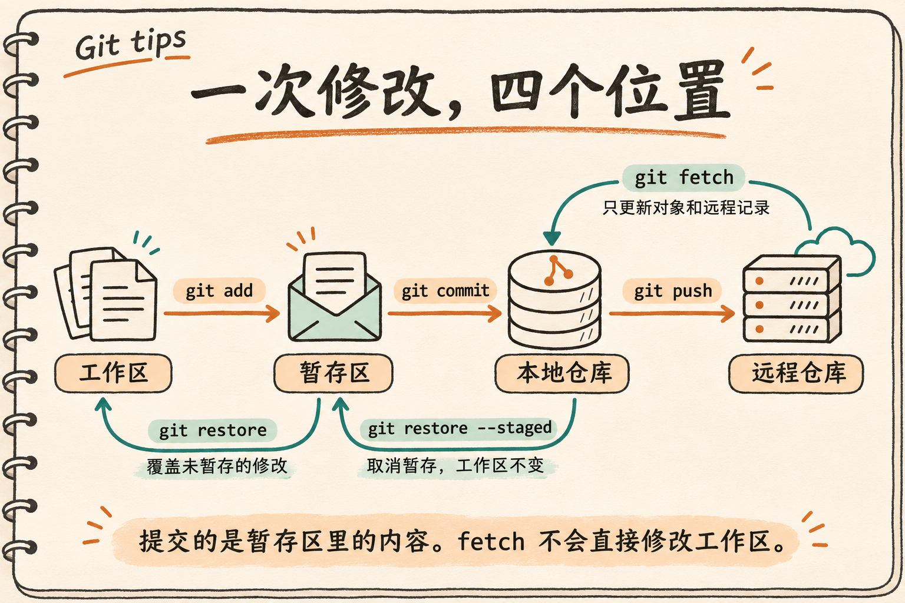
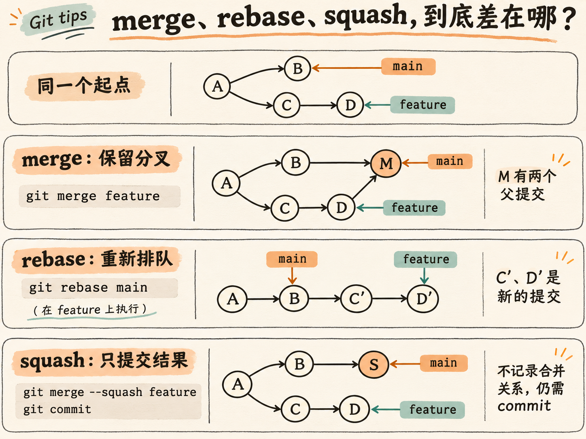
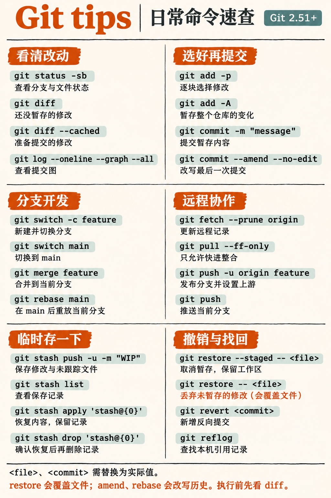

# Git tips

平时用 Git，`add`、`commit`、`push` 往往已经够用了。真正让人停下来查资料的，是只想提交半个文件、刚提交就发现漏了两行，或者手一快，把还没保存的修改弄丢了。

这里整理了 **33 个常用 Git tips**：从建仓库、提交代码，到分支协作和误操作后的补救。每条都可以单独看，找到眼前的问题，试一试对应的命令。希望下次你在终端里犹豫时，这里刚好有用得上的那一条。

本文基于 **Git 2.51+**，示例在 Git 2.56.0 验证。分支操作用 `switch`，文件恢复用 `restore`。命令中的 `<url>`、`<commit>`、`<file>` 需要替换；分支名和路径也请按自己的项目调整。同一代码块里有时会列出几种做法，按需要选择即可。

如果这些 tips 帮到了你，欢迎留个 Star，也欢迎提 Issue 或 PR，一起把容易踩的坑补齐。😊

<details>
<summary>33 个 tips，点开直达</summary>

- [1. init / clone：先把仓库建起来](#1-init--clone先把仓库建起来)
- [2. config：提交之前，先确认你是谁](#2-config提交之前先确认你是谁)
- [3. gitignore：不该进仓库的文件，早点排除](#3-gitignore不该进仓库的文件早点排除)
- [4. remote：origin 只是一个名字](#4-remoteorigin-只是一个名字)
- [5. status：拿不准的时候，先看状态](#5-status拿不准的时候先看状态)
- [6. diff：这次提交里到底有什么](#6-diff这次提交里到底有什么)
- [7. add：一个文件也能分两次提交](#7-add一个文件也能分两次提交)
- [8. commit：把选好的修改存下来](#8-commit把选好的修改存下来)
- [9. mv / rm：重命名、删除和停止跟踪](#9-mv--rm重命名删除和停止跟踪)
- [10. log / show：把历史看清楚](#10-log--show把历史看清楚)
- [11. log：记不住提交号，也能找到它](#11-log记不住提交号也能找到它)
- [12. switch：新功能，从新分支开始](#12-switch新功能从新分支开始)
- [13. branch：分支多了，记得整理](#13-branch分支多了记得整理)
- [14. merge：把做好的功能合回来](#14-merge把做好的功能合回来)
- [15. rebase：让自己的提交接在主线后面](#15-rebase让自己的提交接在主线后面)
- [16. squash：只想留下一个提交](#16-squash只想留下一个提交)
- [17. 冲突：先解决文件，再继续操作](#17-冲突先解决文件再继续操作)
- [18. cherry-pick：只拿其中一个修复](#18-cherry-pick只拿其中一个修复)
- [19. fetch：先看看远程发生了什么](#19-fetch先看看远程发生了什么)
- [20. pull：分叉了，先停一下](#20-pull分叉了先停一下)
- [21. push：把本地提交发出去](#21-push把本地提交发出去)
- [22. tag：给发布版本留个名字](#22-tag给发布版本留个名字)
- [23. restore：取消暂存和丢弃修改要分清](#23-restore取消暂存和丢弃修改要分清)
- [24. stash：没做完的活，先存一下](#24-stash没做完的活先存一下)
- [25. revert：已经推送的提交怎么撤销](#25-revert已经推送的提交怎么撤销)
- [26. reset：三个参数，影响三个地方](#26-reset三个参数影响三个地方)
- [27. reflog：提交找不到了，先别急着清理](#27-reflog提交找不到了先别急着清理)
- [28. clean：删之前，先看一眼名单](#28-clean删之前先看一眼名单)
- [29. amend / rebase -i：提交前后，收拾一下](#29-amend--rebase--i提交前后收拾一下)
- [30. worktree：两个任务，两个工作目录](#30-worktree两个任务两个工作目录)
- [31. grep / blame：这段代码从哪来的](#31-grep--blame这段代码从哪来的)
- [32. bisect：让 Git 帮你找出坏提交](#32-bisect让-git-帮你找出坏提交)
- [33. submodule：仓库里面还有一个仓库](#33-submodule仓库里面还有一个仓库)

</details>

动手前，先认一下下面四个位置。你编辑的是工作区，`add` 选出的内容放进暂存区，`commit` 存到本地仓库，`push` 才会发布到远程。后面那些容易混淆的“撤销”，大多是在这些位置之间取回或覆盖内容。



## 33 个 tips

### 1. init / clone：先把仓库建起来

新项目用 `init`，已有项目用 `clone`，两者选一个：

```sh
git init -b main my-project
git clone <url> my-project
```

后续命令都在项目目录里执行。普通开发建议完整克隆；如果只是临时看看某个分支，可以少取一些历史：

```sh
git clone --depth=10 --branch main <url> my-project
# 后来需要完整历史时，再补齐
git fetch --unshallow
```

浅克隆限制的是历史深度，会影响追溯、变基和二分排错，并不是一个解决大文件下载问题的通用开关。

### 2. config：提交之前，先确认你是谁

换电脑后的第一件小事：设置提交里的姓名和邮箱。

```sh
git config set --global user.name "Your Name"
git config set --global user.email "you@example.com"
# 公司项目单独使用工作邮箱
git config set --local user.email "you@company.example"
git config get user.email
```

常用优先级是 local > global > system。写配置不指定范围时默认写当前仓库，读取时则会合并各层。遇到“明明改了，怎么还没生效”，直接查来源：

```sh
git config list --show-origin --show-scope
# 删除当前仓库的覆盖值
git config unset --local user.email
```

提交身份和远程登录是两回事。改邮箱不能解决 SSH 密钥或 HTTPS 凭据的问题。

### 3. gitignore：不该进仓库的文件，早点排除

构建产物、日志之类的共同规则，放在仓库的 `.gitignore` 并提交：

```gitignore
/build/
*.log
!example.log
```

`!` 可以重新包含文件，但被忽略目录里的文件不能单靠这一条救回来，还需要让父目录也能被遍历。同一层最后匹配的规则生效，更深目录的 `.gitignore` 优先；仓库规则又优先于 `.git/info/exclude` 和全局忽略文件。

个人规则放 `.git/info/exclude`，跨项目的个人规则可放 `~/.config/git/ignore`，也可显式指定。找不到哪个规则在生效时，用 `-v`：

```sh
git config set --global core.excludesFile ~/.config/git/ignore
git check-ignore -v -- build/output.txt
```

已经跟踪的文件不受新规则影响，停止跟踪的方法见第 9 条。如果提交过密钥，忽略或删文件都清不掉历史中的内容，先撤换密钥。

### 4. remote：origin 只是一个名字

`clone` 通常已经替你配置了 `origin`。要添加第二个仓库、换地址或者删除关联时：

```sh
git remote -v
git remote add upstream <url>
git remote set-url origin <new-url>
git remote rename upstream source
git remote remove source
```

`remote remove` 删除的是本地关联及对应的远程跟踪引用，不会把服务器上的仓库删掉。

### 5. status：拿不准的时候，先看状态

```sh
git status -sb
```

`-s` 简洁显示，`-b` 带上分支信息。文件前两列分别是暂存区和工作区的状态，`??` 表示未跟踪。一个文件前出现两个 `M` 并不奇怪：暂存后又编辑了它，就会同时存在两份修改。

遇到冲突或操作中断，直接用完整的 `git status`，它通常会提示下一步该做什么。

### 6. diff：这次提交里到底有什么

提交前值得多看一眼的是 `diff --cached`，它展示的才是暂存区里准备提交的内容。

```sh
git diff                 # 工作区与暂存区
git diff --cached        # 暂存区与 HEAD
git diff HEAD            # 工作区与 HEAD
```

这些命令默认不展示未跟踪文件的内容。比较分支则要分清两个端点和共同祖先：

```sh
git diff main feature/login       # 比较两个分支当前的快照
git diff main...feature/login     # 共同祖先到 feature/login 的变化
```

`diff A..B` 等同于 `diff A B`；`diff A...B` 有方向性，适合看功能分支带来了什么。不要把它和 `log` 的提交范围混为一谈。

### 7. add：一个文件也能分两次提交

改到一半顺手修了另一个问题？不必把它们绑进同一次提交，`-p` 可以逐块选择：

```sh
git add -p
# 也可以指定文件
git add -- README.md
```

交互界面的 `y` 接受当前块，`n` 跳过，`s` 尝试继续拆分，`q` 退出。想一次处理所有变化时，再选下面的写法：

```sh
git add .     # 当前目录及其子目录
git add -A    # 整个仓库，包含新增、修改和删除
git add -u    # 整个仓库，只处理已跟踪文件的修改和删除
```

`add` 保存的是执行那一刻的内容。之后继续编辑的部分，需要再暂存才会进入提交。

### 8. commit：把选好的修改存下来

```sh
git commit -m "Fix login redirect"
```

一次提交说清一件事，后面排错、撤销、挑选提交都会省心一些。`git commit -am "message"` 可以顺便暂存已跟踪文件的修改和删除，但不会加入新文件。

还有两个长得很像的参数：`-s` 添加 `Signed-off-by` 贡献声明，`-S` 才是密码学签名。项目要求 signoff 时用 `git commit -s`，不要把两者当成一回事。

### 9. mv / rm：重命名、删除和停止跟踪

```sh
git mv old-name.txt new-name.txt
git rm -- obsolete.txt
# 保留本地文件，只从版本管理中移除
git rm --cached -- app.log
```

前两条会暂存重命名或删除，最后一条适合配合 `.gitignore` 停止跟踪生成文件。`git rm` 会检查可能丢失的修改，先看看它为什么拒绝，通常不需要直接加 `-f`。

`--cached` 保留的是你当前的本地文件。把删除提交并分享后，其他人更新时也会受到影响；历史里已有的内容仍然存在。

### 10. log / show：把历史看清楚

```sh
git log --oneline --decorate --graph --all
git show <commit>
git shortlog -sn HEAD
```

第一条把分支和提交关系画出来；第二条看某次提交的说明和补丁；第三条按提交数汇总贡献者。

分支名本质上是指向提交的引用，`HEAD` 通常指向当前分支。后面读历史图、做 reset 时，想一想“哪个名字移动了”，会更容易理解。

### 11. log：记不住提交号，也能找到它

```sh
git log --grep="login"                    # 搜索提交说明
git log -S "functionName" -- src/app.js    # 字符串出现次数发生变化的提交
git log --oneline main..feature/login     # feature/login 有、main 没有的提交
```

`-S` 很适合追踪某段代码什么时候被加进来或删掉。`log A..B` 选择从 B 可达、从 A 不可达的提交；`log A...B` 则选择双方独有的提交，是两个集合的对称差。

### 12. switch：新功能，从新分支开始

```sh
git switch -c feature/login
git switch main
git switch -
```

分别是创建并切换、切换到已有分支、回到上一个分支。

切换分支不会替你保存修改：能安全携带的修改可能跟过去，会被覆盖时 Git 会拒绝切换。工作还没做完，先看第 24 条的 stash。

### 13. branch：分支多了，记得整理

```sh
git branch -vv
git branch -m feature/login feature/sign-in
git branch -d feature/sign-in
```

`-vv` 查看本地分支及上游关系。`-d` 会检查是否已合并到上游；没有上游时检查是否已合并到 HEAD。不能删除当前检出的分支；`-D` 会跳过合并检查，使用前确认提交已保留。

只想看看一个发布版本，可以进入 detached HEAD；如果准备继续开发，就给它建个分支：

```sh
git switch --detach v1.0.0
git switch -c fix/old-release
```

游离状态下也能提交，但离开后没有分支名保留新提交，容易把入口弄丢。

### 14. merge：把做好的功能合回来

```sh
git switch main
git merge feature/login
```

方向别弄反：这是把 `feature/login` 合入当前的 `main`。如果 main 没有独立的新提交，通常可以快进，只移动分支引用；双方都有新提交时，通常会生成一个有两个父提交的 merge commit。

需要保留明确的合并节点时，可以用 `git merge --no-ff feature/login`。下面把 merge、rebase 和 squash 放在同一个起点下比较：



### 15. rebase：让自己的提交接在主线后面

功能还没发布，主线已经往前走了，可以在自己的分支上重放提交：

```sh
git switch feature/login
git rebase main
```

完成后，功能提交接在 main 后面，提交 ID 通常会变化。它适合整理自己的分支；别人已经依赖的历史，需要先协调。`main` 也需要先更新，rebase 不会自动替你获取服务器上的最新代码。

### 16. squash：只想留下一个提交

功能分支上有很多调试、修补提交，合入主线时只想留下最终结果：

```sh
git switch main
git merge --squash feature/login
git diff --cached
git commit -m "Add login page"
```

别漏掉最后的 `commit`。`--squash` 只准备工作区和暂存区，不会直接创建提交，也不记录原分支的双亲合并关系。因此 Git 不会仅凭历史认定原功能分支已经合并，后续继续整合它时要留意这一点。

### 17. 冲突：先解决文件，再继续操作

先 `git status` 确认正在 merge、rebase 还是 cherry-pick，再处理文件中的冲突标记。检查结果并暂存后，选择对应的命令继续：

```sh
git add -- <resolved-file>
# 按当前操作选一条
git merge --continue
git rebase --continue
git cherry-pick --continue
```

决定放弃本次操作时，用对应的 `--abort`。开始合并前尽量保持工作区干净，有未提交修改时，中止操作也不保证能完整还原原状。

### 18. cherry-pick：只拿其中一个修复

另一个分支上有一个修复，当前分支也需要，但不想把整个分支都合进来：

```sh
git cherry-pick <commit>
# 多个指定提交，按列出的顺序应用
git cherry-pick <commit1> <commit2>
```

对于线性历史 `P—A—B—C`，`A..C` 选择 B、C；要连 A 一起选，用 `A^..C`，前提是 A 有父提交。先看清范围，再执行：

```sh
git log --reverse --oneline <A>..<C>
git cherry-pick <A>..<C>
```

挑选通常会生成新提交。范围按可达关系选择，不是按日期截取；遇到分叉时尤其要先检查提交列表。

### 19. fetch：先看看远程发生了什么

```sh
git fetch --prune origin
git log --oneline HEAD..origin/main
```

`fetch` 获取对象和远程跟踪引用，不直接改变当前分支、暂存区和工作区。`origin/main` 是本机保存的远程记录，不是服务器的实时状态。

默认的分支配置下，`--prune` 还会清理远程已删除分支的跟踪引用，不删除你的本地开发分支，也不清理标签。配置过自定义 refspec 时，先确认清理范围。

### 20. pull：分叉了，先停一下

上游已配置时，日常更新推荐明确加上快进限制：

```sh
git pull --ff-only
```

它获取更新后只允许快进。双方各自有新提交时，命令会停止，让你选择如何整合。若明确要重放自己的本地提交，再用 `git pull --rebase`。

想把获取和整合拆开看，也可以：

```sh
git fetch origin
git switch main
git merge --ff-only origin/main
```

### 21. push：把本地提交发出去

```sh
git push -u origin feature/login
# 上游建立后，在该分支继续推送
git push
# 功能已合并，删除远程分支
git push origin --delete feature/login
```

`-u` 建立上游关系，后续默认推拉和 ahead/behind 提示都会用到它。推送被拒绝时，先 fetch 看看差异，不要立刻加 `--force`。

<details>
<summary>自己的已发布分支经过 rebase，确实需要更新远程历史时</summary>

先确认团队允许，并检查远程已有的工作是否保留，再锁定你审查过的版本：

```sh
git fetch origin
git log --oneline --left-right HEAD...origin/feature/login
expected=$(git rev-parse refs/remotes/origin/feature/login)
git push --force-with-lease=refs/heads/feature/login:"$expected" origin HEAD:refs/heads/feature/login
```

只有远程仍指向 `expected` 时才接受更新。不带预期值的 lease 依赖远程跟踪引用，后台 fetch 可能削弱保护。显式预期值也只检查远程有没有变化，不检查你的新历史是否丢失改动，仍需要审查和协作。

</details>

### 22. tag：给发布版本留个名字

```sh
git tag -a v1.0.0 -m "Release 1.0.0"
git push origin v1.0.0
```

分支会随提交向前走，标签通常留在发布时的提交上。普通分支推送不会顺便发布所有标签，建议明确推送需要的标签。

误建标签时，本地和远程需要分别删除；已经对外发布的标签通常不应重写：

```sh
git tag -d v1.0.0
git push origin --delete tag v1.0.0
```

### 23. restore：取消暂存和丢弃修改要分清

文件 add 多了，和文件改错了，是两件事：

```sh
# 取消暂存：默认从 HEAD 恢复暂存区，工作区不变
git restore --staged -- README.md
# 丢弃未暂存的修改：默认从暂存区覆盖工作区
git restore -- README.md
```

第二条会丢失未暂存的修改。Git 通常救不回从未暂存或提交的文本，执行前先看 `diff`。这里的 `--` 把文件路径和选项分开。

也可以从指定提交取回文件，默认只改工作区，确认后仍需 add、commit：

```sh
git restore --source=<commit> -- README.md
# 让暂存区和工作区都回到 HEAD，会丢弃该文件所有未提交修改
git restore --source=HEAD --staged --worktree -- README.md
```

仓库尚无首次提交时，没有 HEAD，新加文件可以用 `git rm --cached -- <file>` 取消跟踪并保留工作区文件。

### 24. stash：没做完的活，先存一下

临时切去修 bug，又不想提交半成品：

```sh
git stash push -u -m "WIP: login form"
git stash list
git stash show -p --include-untracked 'stash@{0}'
git stash apply 'stash@{0}'
# 确认恢复正确后再删除记录
git stash drop 'stash@{0}'
```

默认保存已跟踪文件的修改，`-u` 额外包含未跟踪文件，仍不包含忽略文件。`apply` 保留记录，`pop` 在成功恢复后移除；发生冲突时 pop 会保留记录。需要尝试还原暂存状态时，用 `apply --index`。

`--keep-index` 适合把暂存内容留下单独测试，但 stash 仍会记录这部分内容。stash 冲突没有专用的 `--continue`，处理好文件后正常暂存、提交即可。不要在确认恢复前清空记录。

<details>
<summary>换台电脑继续做：传递 stash</summary>

stash 不会随普通分支推送自动传递，可以导出选定记录，用一个专用的新分支传输：

```sh
# 发送端
git stash export --to-ref refs/heads/wip-transfer 'stash@{0}'
git push origin refs/heads/wip-transfer
# 接收端
git fetch origin refs/heads/wip-transfer
git stash import FETCH_HEAD
```

导出会更新指定引用，不要用正常开发分支的名字。导入会追加本机 stash 记录；内容可能包含未跟踪文件，推送前检查是否适合分享。

</details>

### 25. revert：已经推送的提交怎么撤销

提交已经被别人拉走，通常用一个新的反向提交撤销改动：

```sh
git revert <commit>
```

需要把线性历史 `A..C` 中的 B、C 一起撤销成一个提交时：

```sh
git revert --no-commit <A>..<C>
git diff --cached
git commit -m "Revert the selected changes"
```

这里用两点范围。三点表示双方独有提交，不能用它表达“排除 A、包含 C”。冲突解决并 add 后用 `git revert --continue`，放弃则用 `git revert --abort`。

merge commit 还需要选择主线，例如 `git revert -m 1 <merge-commit>` 会反向应用相对第一个父提交的变化。合并关系仍在，之后再合并原分支不会简单重放已撤销的祖先提交，操作前先确认意图。

### 26. reset：三个参数，影响三个地方

假设已经有提交，且没有未解决的冲突：

| 命令 | 当前分支 | 暂存区 | 工作区 |
|---|---|---|---|
| `git reset --soft <commit>` | 移到目标提交 | 不变 | 不变 |
| `git reset --mixed <commit>` | 移到目标提交 | 恢复成目标快照 | 不变 |
| `git reset --hard <commit>` | 移到目标提交 | 恢复成目标快照 | 覆盖为目标快照 |

想退回本地提交、重新组织内容时，通常选 soft 或默认的 mixed。hard 还会丢弃工作区修改，别把它当作普通的“更新代码”。

`--hard` 不会普遍删除所有未跟踪文件，但会删除阻碍写入目标文件的未跟踪文件或目录。共享历史通常用 revert，reset 适合明确允许重写的本地历史。detached HEAD 下移动的是 HEAD 本身。

### 27. reflog：提交找不到了，先别急着清理

误 reset 或删分支后，先找旧提交，再建一个救援分支，不必立刻再次覆盖工作区：

```sh
git reflog --date=local
git show <lost-commit>
git branch rescue/lost-work <lost-commit>
```

reflog 记录本机引用变化，不随 push 分享，也不永久保留。找到的提交尚未被清理时，这个分支就能替你保留入口。

<details>
<summary>reflog 找不到，或者误删了 stash</summary>

先停止清理，复制整个仓库作为现场备份。要包含 `.git`，linked worktree 还要备份它指向的公共 Git 目录；普通 clone 不会完整复制不可达对象。

```sh
git fsck --full --no-reflogs --unreachable
git show <candidate-commit>
git branch rescue/recovered <candidate-commit>
```

输出里有些只是正常旧对象，逐个确认内容。若找到误删的 stash commit，用 `git stash apply <stash-commit>` 恢复；创建分支或 cherry-pick 不一定能还原暂存区和未跟踪文件。

Git 平时会自动做部分维护，一般不必手动运行 `git gc`。gc 会压缩对象，并按过期策略清理部分不可达对象；恢复期间不要运行它，尤其不要使用 `--prune=now`。对象已清理，或文本从未保存到 Git，都无法保证恢复。

</details>

### 28. clean：删之前，先看一眼名单

```sh
git clean -nd -- build/    # 预览
git clean -fd -- build/    # 确认后删除
```

`-d` 包含未跟踪目录，默认遵守忽略规则。需要连被忽略的文件也纳入范围时，先用 `git clean -ndx` 看清名单，再决定是否执行对应删除命令。两次执行之间文件若有变化，删除范围也会变。

缓存里也可能有还没备份的本地数据，别养成顺手执行 `reset --hard` 加 `clean` 的习惯。未跟踪文件通常无法从 reflog 找回。

### 29. amend / rebase -i：提交前后，收拾一下

刚提交就发现漏了一个文件，可以更新最后一次提交：

```sh
git add -- <file>
git commit --amend --no-edit
# 需要一起修改提交说明时，用 git commit --amend
```

amend 会替换分支顶端的提交，ID 会变化。若要整理最近三个提交，且这些提交允许重写、`HEAD~3` 存在：

```sh
git branch backup/before-rebase
git rebase -i HEAD~3
```

编辑器中从旧到新排列：`pick` 保留，`reword` 改说明，`squash` 合到前一条并编辑说明，`fixup` 合到前一条但丢弃本条说明，`drop` 丢弃。删掉有用历史并不会让项目更好维护，整理到能看懂就够了。

换基点时可用 `git rebase --onto main old-base topic`：选择 topic 中不属于 old-base 历史的提交，在 main 后重放，并更新 topic。合并、重复补丁和空提交还会受到 rebase 处理规则影响，不是简单按两个端点复制。

### 30. worktree：两个任务，两个工作目录

不用为了修一个紧急问题，把手头的工作来回 stash：

```sh
git worktree add -b fix/urgent ../project-urgent main
git worktree list
# 在新目录完成并提交后，再移除工作目录
git worktree remove ../project-urgent
```

各目录有独立工作区、暂存区和 HEAD，共享对象、引用及大部分配置。同一本地分支默认不能同时在两个 worktree 检出；用 `remove` 让 Git 检查未提交内容，不要直接删目录。失效记录先用 `git worktree prune --dry-run` 看，再用 `git worktree prune` 清理。

需要完全没有父提交的独立历史，例如单独发布文档时，可以创建一个空的新工作目录：

```sh
git worktree add --orphan -b site ../project-site
```

目录初始没有已跟踪文件，首次提交会成为新的根提交。

### 31. grep / blame：这段代码从哪来的

```sh
git grep -n -e "TODO" -- src/
git grep -n -e "oldFunction" <commit> -- src/
git blame -L 10,30 -- src/app.js
git log -p -- src/app.js
```

`grep` 默认搜索已跟踪文件，也能查历史提交；`blame` 显示每行最后一次相关修改。别只看作者姓名就下结论，跟进提交补丁和上下文，才能知道当时为什么那样改。

### 32. bisect：让 Git 帮你找出坏提交

已知一个正常版本和一个错误版本，Git 可以逐步检出中间版本，你只需测试并反馈好坏：

```sh
git bisect start
git bisect bad <bad-commit>
git bisect good <good-commit>
# 每次测试后，根据结果选一条
git bisect good
git bisect bad
# 当前版本无法测试时
git bisect skip
# 找到问题或决定停止后，回到开始前的位置
git bisect reset
```

工作区先保持干净。检查可以自动化时，用 `git bisect run ./test-regression.sh`：返回 0 表示正常，1～127（125 除外）表示错误，125 表示跳过，其他返回值中止查找。注意测试程序是否真的在检测这个 bug，别把缺少构建工具当成代码有问题。

### 33. submodule：仓库里面还有一个仓库

主仓库记录子模块的提交 ID 和 `.gitmodules` 配置。克隆时一次取全，或者在已有仓库里补初始化：

```sh
git clone --recurse-submodules <url> project
git submodule update --init --recursive
# 添加新子模块
git submodule add <library-url> vendor/library
git commit -m "Add library submodule"
```

修改子模块时，先在里面创建分支、提交并推送，再回主仓库记录新指针：

```sh
git add -- vendor/library
git commit -m "Update library revision"
```

默认 update 常把子模块放在 detached HEAD。需要的通常是主项目记录的固定版本；加 `--remote` 会改为按远程分支更新，主项目仍要提交指针变化。先推子模块，再推主项目，避免别人拿到一个无法获取的提交 ID。

## 顺手的 alias

正文和速查图都写完整命令，敲熟了再挑几个 alias 就好。Git alias 通过 `git sw main` 这样的形式调用：

```sh
git config set --global alias.sw switch
git config set --global alias.swc "switch -c"
git config set --global alias.unstage "restore --staged"
```

`--global` 对当前用户生效，只想在本仓库试用就改用 `--local`。删除某项用 `git config unset --global alias.sw`。下面的配置可以按需合入用户 Git 配置的 `[alias]` 段，不要覆盖文件中的其他内容，也不要直接粘贴到 shell 执行：

```gitconfig
[alias]
    st = status --show-stash
    sti = status --ignored --show-stash
    df = diff
    dfc = diff --cached
    lg = log
    lgo = log --oneline
    lgga = log --graph --oneline --decorate --all
    so = show
    a = add
    aa = add -A
    ap = add -p
    cm = commit
    sw = switch
    swc = switch -c
    br = branch -vv
    fh = fetch
    pl = pull --ff-only
    ps = push
    sh = stash
    unstage = restore --staged
```

`aa` 会暂存整个仓库，`pl` 遇到分叉会停止。覆盖文件、强制删除、改写历史这些操作，保留完整命令更容易看清自己在做什么；是否添加 signoff 也由项目约定决定。

## 日常速查

把常用的 24 条命令放在一张图里，方便需要时翻出来看。完整解释和边界情况见对应的 tip。



## 参考资料

想继续往下挖，推荐官方手册和 Pro Git。简短帮助用 `git <command> -h`，完整手册用 `git help <command>`（需要本机安装文档）。

- [Git 官方命令手册](https://git-scm.com/docs)：按命令查参数。
- [git-config](https://git-scm.com/docs/git-config)：配置、作用域和别名。
- [git-diff](https://git-scm.com/docs/git-diff)、[gitrevisions](https://git-scm.com/docs/gitrevisions)：快照比较与提交范围。
- [git-restore](https://git-scm.com/docs/git-restore)、[git-reset](https://git-scm.com/docs/git-reset)、[git-revert](https://git-scm.com/docs/git-revert)、[git-stash](https://git-scm.com/docs/git-stash)：撤销、恢复和临时保存。
- [git-merge](https://git-scm.com/docs/git-merge)、[git-rebase](https://git-scm.com/docs/git-rebase)、[git-push](https://git-scm.com/docs/git-push)：整合与发布历史。
- [gitignore](https://git-scm.com/docs/gitignore)：忽略规则。
- [git-worktree](https://git-scm.com/docs/git-worktree)：多个工作目录。
- [git-bisect](https://git-scm.com/docs/git-bisect)：二分排错。
- [git-submodule](https://git-scm.com/docs/git-submodule)：子模块。
- [git-fsck](https://git-scm.com/docs/git-fsck)、[git-gc](https://git-scm.com/docs/git-gc)、[git-reflog](https://git-scm.com/docs/git-reflog)：检查、维护与恢复。
- [Pro Git 中文版](https://git-scm.com/book/zh/v2)：系统学习 Git。
- [Learn Git Branching](https://learngitbranching.js.org/?locale=zh_CN)：交互式练习分支与历史操作。
