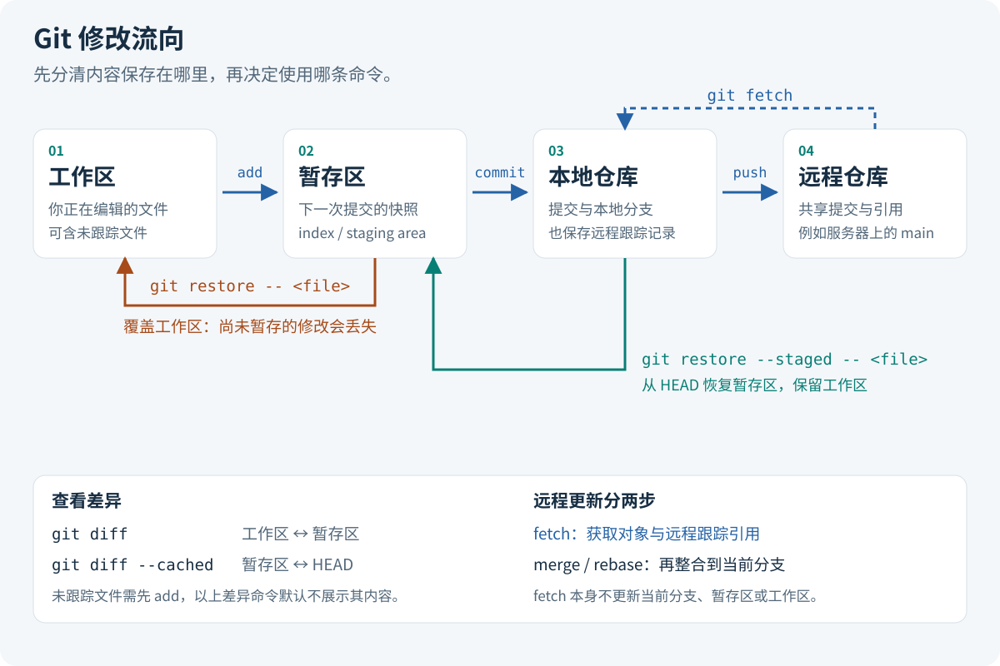
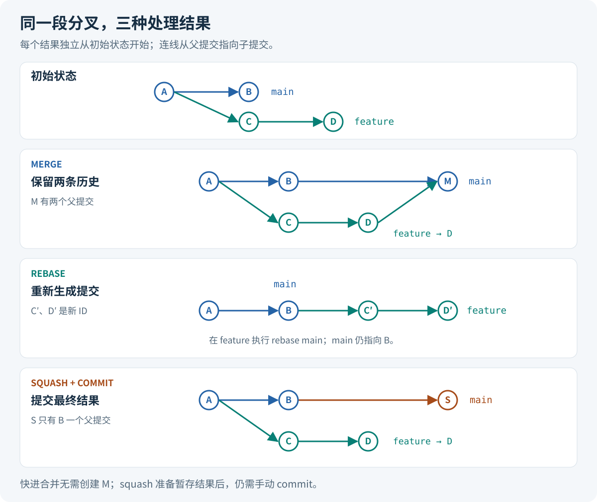
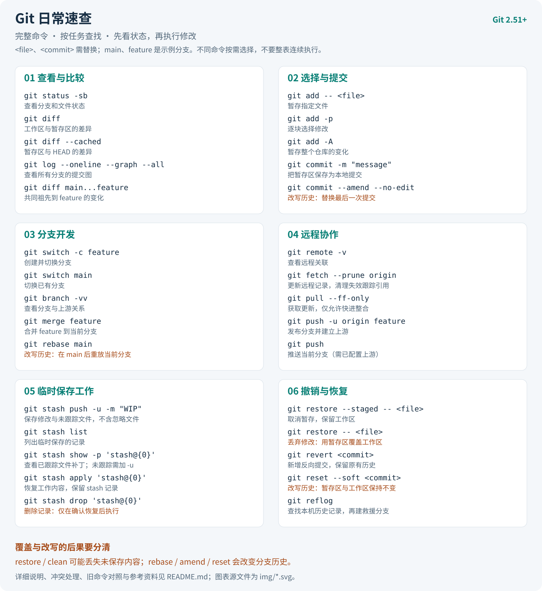

# Git 日常开发手册

面向日常开发的中文 Git 手册，以 **Git 2.51+** 为内容基线。先理解修改流向，再按任务查找命令；不必记住每个子命令的所有参数。

分支切换使用 `switch`，文件恢复使用 `restore`，配置使用 `config get/set/list/unset`，临时保存工作使用 `stash push`。示例在 Git 2.56.0 验证。

- [理解修改流向](#理解修改流向)
- [开始使用](#开始使用)
- [查看与提交](#查看与提交)
- [分支开发](#分支开发)
- [远程协作](#远程协作)
- [撤销与恢复](#撤销与恢复)
- [进阶操作](#进阶操作)
- [推荐别名](#推荐别名)
- [命令索引](#命令索引)
- [中文速查表](#中文速查表)
- [参考资料](#参考资料)

示例使用常见 shell 语法。`<url>`、`<commit>` 等表示需要替换的值，不要连尖括号一起输入；`main`、`feature/login`、`README.md` 等是示例名称，请按实际仓库调整。代码块中的不同操作通常是备选做法，不是要从头到尾全部执行。`--` 用于把文件路径与选项、提交名分开。

## 理解修改流向

Git 的提交是一份快照。你编辑的是**工作区**，用 `add` 选择放入**暂存区**的内容，再用 `commit` 生成**本地提交**。同一文件可以同时有已暂存和未暂存的修改，所以提交前需要分别查看两种差异。

分支是指向提交的可移动引用。通常 `HEAD` 指向当前分支，提交后分支随之向前移动。`origin/main` 是本地保存的远程分支记录，只有获取远程信息后才会更新，不能把它当成服务器的实时状态。



`fetch` 只取回远程对象和引用，不直接改写工作区；`merge` 或 `rebase` 才把另一段历史整合到当前分支。`push` 则把本地提交发布到远程。理解这几个边界，比记忆一组“同步代码”的组合命令更有用。

## 开始使用

### 创建或克隆仓库

新项目先初始化，已有项目直接克隆，两者选其一：

```sh
git init -b main my-project
git clone <url> my-project
```

进入项目目录后再执行后续操作。`clone` 默认创建名为 `origin` 的远程关联。远程地址常见 HTTPS 和 SSH 两种，身份认证由服务端和本机凭据配置决定；提交里的姓名和邮箱不负责登录。

只需要某个分支的近期历史时，可以浅克隆：

```sh
git clone --depth=10 --branch main <url> my-project
# 已有浅克隆需要完整历史时
git fetch --unshallow
```

`--depth` 限制历史深度，并默认只克隆一个分支，不代表只下载“大文件的最近版本”。浅历史会限制追溯、变基和二分排错，普通开发优先使用完整克隆。

### 设置身份与查看配置

首次使用设置用户级身份，多账号时在具体仓库覆盖：

```sh
git config set --global user.name "Your Name"
git config set --global user.email "you@example.com"
# 仅对当前仓库生效
git config set --local user.email "you@company.example"
# 查询最终生效值与来源
git config get user.email
git config list --show-origin --show-scope
# 删除当前仓库的覆盖值，重新使用上层配置
git config unset --local user.email
```

常用配置层级是 system → global → local，后者覆盖前者。写配置时不指定范围默认写入当前仓库；查询时会合并各层配置。全局配置通常保存在 `~/.gitconfig` 或 `$XDG_CONFIG_HOME/git/config`，仓库配置通常在 `.git/config`，用 `--show-origin` 查看实际位置比猜文件路径可靠。

### 忽略生成文件

把团队共同忽略的规则写进仓库根目录的 `.gitignore` 并提交：

```gitignore
# 构建目录与日志
/build/
*.log
# 保留一个示例日志；父目录不能同时被排除
!example.log
```

`.gitignore` 只影响尚未跟踪的文件。已经提交的文件不会因为新增规则自动退出版本管理。若要停止跟踪，同时保留本地文件：

```sh
git rm --cached -- app.log
git add .gitignore
git commit -m "Stop tracking generated log"
```

这会在下一次提交中删除仓库里的文件，其他人更新后也会受到影响；历史中的旧内容仍然存在。如果文件含有密钥，仅添加忽略规则或取消跟踪不能清除泄露，需要立即撤换密钥。

个人专用规则放在 `.git/info/exclude`，跨项目规则可写入 `~/.config/git/ignore`（默认使用 XDG 配置目录），也可显式设置：

```sh
git config set --global core.excludesFile ~/.config/git/ignore
git check-ignore -v -- build/output.txt
```

同一层规则最后匹配者生效；更深目录的 `.gitignore` 优先于上层文件，仓库内规则优先于 `.git/info/exclude` 和全局忽略文件。排查时用 `check-ignore -v` 查看具体命中的规则。

## 查看与提交

### 看清即将提交的内容

```sh
git status -sb
git diff
git diff --cached
git diff HEAD
```

`status -sb` 用简洁格式显示分支及文件状态。文件前两列分别表示暂存区状态、工作区状态，`??` 表示未跟踪。`diff` 比较工作区与暂存区，`diff --cached` 比较暂存区与 `HEAD`，`diff HEAD` 比较工作区与 `HEAD`；这些差异命令默认不会显示未跟踪文件的内容。

### 选择修改并提交

一次提交尽量只解决一个问题。既可以选文件，也可以逐块选择同一文件中的修改：

```sh
git add -- README.md
git add -p
# 确认范围后，也可以暂存整个仓库的新增、修改与删除
git add -A
git diff --cached
git commit -m "Describe the change"
```

`add .` 处理当前目录及其子目录，`add -A` 处理整个仓库，`add -u` 只处理已跟踪文件的修改和删除。`add` 只是暂存，不是提交；暂存后继续编辑的内容不会自动进入同一次提交。

移动、重命名、删除已跟踪文件也可以直接暂存：

```sh
git mv README.md GUIDE.md
git rm -- obsolete.txt
```

`git rm` 会删除工作区文件并暂存删除，遇到可能丢失的修改时会拒绝执行。先检查修改，通常不需要 `-f`。Git 根据内容识别重命名，不要求一定用 `git mv`。

`git commit -am "message"` 可以自动暂存已跟踪文件的修改和删除，但不会加入新文件。团队若要求 signoff，可用 `git commit -s` 添加 `Signed-off-by` 声明；这是贡献声明，密码学签名使用 `git commit -S`，两者含义不同。

### 回看历史和比较分支

```sh
git log --oneline --decorate --graph --all
git show <commit>
git log --grep="login"
git log -S "functionName" -- src/app.js
git shortlog -sn HEAD
```

`log` 展示提交历史，`show` 展示某次提交的说明和补丁。`--grep` 搜索提交说明，`-S` 寻找某字符串出现次数发生变化的提交。`shortlog -sn HEAD` 按提交数量汇总当前历史中的贡献者。

比较分支时，先确定自己想看哪一种差异：

```sh
# 两个端点的文件快照差异
git diff main feature/login
# 从共同祖先到 feature/login 的变化，常用于审查功能分支
git diff main...feature/login
# feature/login 中可达、main 中不可达的提交
git log main..feature/login
```

`diff A B` 与 `diff A..B` 都比较两个端点；`diff A...B` 比较共同祖先与 B，具有方向性。`log A..B` 是提交集合的筛选，`log A...B` 则取双方各自独有的提交。相同的点号在 `diff` 和 `log` 中不能按同一个意思理解。

## 分支开发

### 创建、切换与删除分支

```sh
git switch -c feature/login
git switch main
git switch -
git branch -vv
git branch -m feature/login feature/sign-in
git branch -d feature/sign-in
```

`switch -c` 创建并切换分支，`switch -` 回到上一个分支；`branch -vv` 查看本地分支和上游关系。`branch -d` 检查分支是否已合并到它的上游；未设置上游时检查是否已合并到 `HEAD`。需要删除的分支不能是当前检出的分支，强制删除 `-D` 会跳过合并检查。

切换分支不等于保存修改。能安全携带的未提交修改可能随切换保留；会被覆盖时 Git 会拒绝切换。先提交或使用 [stash](#临时保存工作)，不要把强制切换当成常规做法。

临时查看一个标签或历史提交时，可以进入 detached HEAD：

```sh
git switch --detach v1.0.0
# 如果要在此基础上继续提交，先给它创建分支
git switch -c fix/old-release
```

detached HEAD 表示 `HEAD` 直接指向提交。此时仍能提交，但离开后没有分支名替你保留新提交，最好先创建分支。

### 合并与变基

完成一个功能后，把它合并进当前分支：

```sh
git switch main
git merge feature/login
```

当 `main` 是功能分支的祖先时，默认可以直接快进：只移动分支引用，不创建合并提交。双方都有新提交时，通常会生成一个有两个父提交的 merge commit。需要明确保留合并节点时可用 `git merge --no-ff feature/login`。



功能分支还没有被别人依赖时，可以把自己的提交重新放到最新主线之后：

```sh
git switch feature/login
git rebase main
```

`rebase` 重放提交，会生成新的提交 ID。它适合整理个人分支；已共享的分支需要团队协调。只想把功能结果变成一个提交时，在目标分支执行 `git merge --squash feature/login`，检查暂存区后再手动 `git commit`。squash 不记录双亲合并关系，因此后续 Git 不会仅凭历史认定原功能分支已合并。

### 处理冲突与挑选提交

发生冲突时，先用 `git status` 确认处于哪种操作，再编辑文件、处理 `<<<<<<<` 等冲突标记，运行项目检查并暂存结果：

```sh
git add -- <resolved-file>
# 按当前操作选择一条继续命令
git merge --continue
git rebase --continue
```

若决定放弃此次操作，使用对应的 `git merge --abort` 或 `git rebase --abort`。开始合并前尽量保持工作区干净，有未提交修改时中止操作也不保证能完整重建原状。

只需要另一个分支中的某个修复时，不必合并整条分支：

```sh
git cherry-pick <commit>
# 解决冲突并 add 后继续，或放弃本次挑选
git cherry-pick --continue
git cherry-pick --abort
```

`cherry-pick` 把指定提交的改动应用到当前分支，通常生成新的提交 ID。提交范围与交互式历史整理见[整理提交历史](#整理提交历史)。

## 远程协作

### 管理远程关联

```sh
git remote -v
git remote add origin <url>
git remote set-url origin <new-url>
git remote rename origin upstream
git remote remove upstream
```

`origin` 只是约定俗成的名字。`clone` 已经添加它时无需重复执行 `remote add`。重命名或移除关联不会删除服务器上的仓库，移除后会失去该关联的本地远程跟踪引用。

### 获取更新并整合

```sh
git fetch --prune origin
git log --oneline HEAD..origin/main
git switch main
git merge --ff-only origin/main
```

`fetch --prune` 更新远程跟踪引用，并清理远程已删除分支对应的本地跟踪引用，不会删除你的本地开发分支。这里默认的分支 refspec 不会清理标签；自定义 refspec 时需要确认实际作用范围。

`merge --ff-only` 只允许快进；分叉时停止，留给你决定如何整合。当前分支配置好上游后，`git pull --ff-only` 可以完成获取与快进整合。若明确要重放当前分支的本地提交，则使用 `git pull --rebase`。`pull` 的整合方式受参数和配置影响，不宜一概称为 fetch 加 merge。

### 发布分支和标签

```sh
git push -u origin feature/login
# 上游建立后，后续在该分支推送
git push
# 创建带说明的发布标签并单独推送
git tag -a v1.0.0 -m "Release 1.0.0"
git push origin v1.0.0
```

`-u` 建立上游关系，用于后续默认推拉及 ahead/behind 提示。普通分支推送不会自动发布所有标签；发布时优先推送明确的标签。

分支合并后，可删除远程分支和本地分支；误建标签也需要区分本地与远程：

```sh
git push origin --delete feature/login
git branch -d feature/login
git tag -d v1.0.0
git push origin --delete tag v1.0.0
```

这些是删除操作，执行前确认目标，已发布的标签通常不应重写。若个人分支经过 rebase，常规推送会因历史不再快进而拒绝；需要协调后使用带明确预期值的 `--force-with-lease`，示例见[改写历史后的推送](#改写历史后的推送)。它仍然会改写远程历史。

## 撤销与恢复

先区分要处理的是工作区修改、暂存内容，还是已经存在的提交。下面的表适用于已有提交、普通无冲突状态；`<commit>` 表示你明确选择的目标提交。

| 目的 | 命令 | 结果 |
|---|---|---|
| 取消某文件的暂存 | `git restore --staged -- README.md` | 暂存区回到 HEAD，工作区不变 |
| 丢弃某文件尚未暂存的修改 | `git restore -- README.md` | 用暂存区覆盖工作区，修改会丢失 |
| 从旧提交取回文件 | `git restore --source=<commit> -- README.md` | 只覆盖工作区，确认后仍需 add、commit |
| 撤销一个已共享提交的改动 | `git revert <commit>` | 新增一个反向提交，保留原有历史 |
| 退回本地提交，保留暂存内容 | `git reset --soft <commit>` | 移动当前分支，暂存区和工作区不变 |
| 退回本地提交，重新选择暂存内容 | `git reset --mixed <commit>` | 移动当前分支并重置暂存区，工作区不变 |
| 丢弃本地修改并回到指定提交 | `git reset --hard <commit>` | 移动当前分支，覆盖暂存区与工作区 |

### 恢复文件与取消暂存

`restore --staged` 默认从 `HEAD` 恢复暂存区；不带 `--staged` 时默认从暂存区恢复工作区。两者来源和影响范围不同，不能混用。`restore` 不会移动分支，也不能“撤销一次提交”。仓库还没有首次提交时不存在 `HEAD`，新加文件可用 `git rm --cached -- <file>` 取消跟踪并保留工作区文件。

需要让某文件的暂存区和工作区都回到 `HEAD` 时可以执行：

```sh
# 会丢弃该文件所有未提交修改，先检查 diff 与 diff --cached
git restore --source=HEAD --staged --worktree -- README.md
```

工作区中从未暂存或提交的内容通常无法通过 Git 恢复，执行覆盖操作前先保存需要保留的内容。

### 临时保存工作

任务还没做完又需要切换分支时，先临时保存：

```sh
git stash push -u -m "WIP: login form"
git stash list
git stash show -p --include-untracked 'stash@{0}'
git stash apply 'stash@{0}'
# 确认恢复正确后，再删除这一条记录
git stash drop 'stash@{0}'
```

默认 stash 保存已跟踪文件的工作区和暂存区状态；`-u` 额外保存未跟踪文件，仍不包含被忽略的文件。`apply` 保留 stash 记录，`pop` 只在成功恢复后移除，发生冲突时记录会保留。需要尝试恢复原来的暂存状态时使用 `apply --index`，仍可能冲突。

`stash push --keep-index` 会让已暂存修改留在工作区及暂存区，适合单独测试暂存内容；stash 本身仍会记录已暂存修改，不能理解成“只保存未暂存部分”。stash 冲突没有专用的 `--continue` 命令，处理好文件后正常暂存、提交即可。`drop` / `clear` 会移除恢复入口，不应当作清理工作区的常用命令。

### 撤销提交与找回历史

已发布且被别人依赖的提交，通常使用 `revert`：

```sh
git revert <commit>
# 冲突解决并 add 后继续，或中止操作
git revert --continue
git revert --abort
```

`reset` 则适用于明确要重写的本地历史。`--soft` 只移动提交位置，默认的 `--mixed` 再把暂存区恢复成目标快照，`--hard` 还覆盖工作区。`--hard` 不会普遍删除所有未跟踪文件，但会删除阻碍写入目标文件的未跟踪文件或目录，所以它也不是保留未跟踪文件的保证。

误操作移动了分支时，先查本地 reflog，再创建救援分支，避免立刻再次覆盖工作区：

```sh
git reflog --date=local
git show <lost-commit>
git branch rescue/lost-work <lost-commit>
```

reflog 是本机引用变化记录，不会随 push 共享，也不会永久保留。它可以帮助找回尚未清理的提交，却不能保证找回从未被 Git 保存的文本。

### 清理未跟踪文件

先预览，再按路径删除。两次命令之间若文件有变化，实际删除范围也会变化：

```sh
git clean -nd -- build/
git clean -fd -- build/
```

`-d` 包含未跟踪目录，默认仍遵守忽略规则；`-x` 会把被忽略的内容也纳入范围，例如本地配置、缓存或构建产物。只有确认所有目标均可丢弃时才考虑 `git clean -ndx` 预览和相应删除命令。未跟踪文件通常无法用 reflog 找回，`reset --hard` 加 `clean` 不应当作为日常“同步”方法。

## 进阶操作

日常提交与协作之外，下面介绍历史整理、多工作目录、排错和维护。改写历史前先确认提交是否已被别人依赖。

### 整理提交历史

#### 修改最后一次提交

发现刚提交的说明或内容需要调整，并且尚未被别人依赖时：

```sh
git add -- <file>
git commit --amend
# 沿用原说明，只更新内容
git commit --amend --no-edit
```

amend 会用新提交替换分支顶端的提交，提交 ID 会变化，不是直接修改原对象。`--date` 设置作者日期，不代表同时设置提交者日期；普通历史整理不需要人为调整时间。

#### 交互式变基与指定基点

整理当前分支最近三个提交，前提是存在 `HEAD~3`，并且这些提交允许重写：

```sh
git rebase -i HEAD~3
```

编辑器中按从旧到新的顺序列出提交。保留 `pick` 表示照常重放，`reword` 修改说明，`squash` 把该条合入前一条并编辑说明，`fixup` 合入前一条且丢弃该条说明，`drop` 丢弃该条。不要仅为“更整洁”删掉有用的历史；操作前可用 `git branch backup/before-rebase` 保留入口。

需要把基于 `old-base` 开发的 topic 分支迁移到 `main` 上时：

```sh
git rebase --onto main old-base topic
```

这里选择 topic 中不属于 old-base 历史的提交，在 main 上重新生成它们，并更新 topic。它不是把两个端点之间的所有内容无条件复制，遇到合并、已应用补丁或空提交时还会受 rebase 的处理规则影响。

#### 提交范围

对于下面的线性历史，`A..C` 选择 B、C；`A^..C` 还包含 A，但要求 A 有父提交。

```text
P --- A --- B --- C
```

挑选一段提交时先查看选择结果：

```sh
git log --reverse --oneline <A>..<C>
git cherry-pick <A>..<C>
```

撤销同一段线性历史时可以合并为一次反向提交：

```sh
git revert --no-commit <A>..<C>
git diff --cached
git commit -m "Revert the selected changes"
```

范围的含义是“从 C 可达但从 A 不可达的提交”，不是按日期截取。分叉历史要先核对实际提交集合。`A...C` 是双方独有提交的对称差，不能用它表达“排除 A、包含 C”。

撤销 merge commit 还需要 `git revert -m 1 <merge-commit>` 这类主线选择。`-m 1` 指保留第一个父提交对应的主线，把 merge 相对它的变化反向应用；撤销后合并关系仍在，日后再次合并不会简单重放已撤销的祖先提交。先确认父提交和团队意图再操作。

### 改写历史后的推送

在自己的已发布功能分支上 rebase 或 amend 后，需要更新远程分支。先确认团队允许，获取并审查远程版本，然后锁定你确实看过的提交：

```sh
git fetch origin
git log --oneline --left-right HEAD...origin/feature/login
expected=$(git rev-parse refs/remotes/origin/feature/login)
git push --force-with-lease=refs/heads/feature/login:"$expected" origin HEAD:refs/heads/feature/login
```

服务器只在远程分支仍指向 `expected` 时接受更新；别人之后推入新提交会让本次推送失败。审查时也需要确认远程已有的工作仍被保留或明确允许替换：lease 只检查远程是否变化，不检查你的新历史是否丢失改动。

不带预期值的 `--force-with-lease` 依赖本地远程跟踪引用；后台 fetch 可能更新它，削弱“我看过这个版本”的保护。显式预期值更清楚，但仍然是历史改写，不能绕过分支保护，也不能替代协作约定。

### 多个工作目录

需要保留正在编辑的功能，同时处理一个紧急修复时，可以共享同一个仓库的对象，检出到不同目录：

```sh
git worktree add -b fix/urgent ../project-urgent main
git worktree list
# 在 ../project-urgent 中完成工作并提交后，再移除该工作目录
git worktree remove ../project-urgent
```

每个 worktree 有独立的工作区、暂存区和 HEAD，大部分仓库配置、引用及对象共享。同一个本地分支默认不能同时在两个 worktree 检出。使用 `worktree remove` 让 Git 检查未提交内容，不要直接删目录；已经从磁盘移除的旧目录记录可用 `git worktree prune --dry-run` 检查，再用 `git worktree prune` 清理。

如果确实需要没有父提交的新历史，例如单独发布文档，可用：

```sh
git worktree add --orphan -b site ../project-site
```

这个工作目录初始没有已跟踪文件，首次提交将成为新的根提交。

### 定位问题

#### 搜索内容与追踪来源

```sh
git grep -n -e "TODO" -- src/
git grep -n -e "oldFunction" <commit> -- src/
git blame -L 10,30 -- src/app.js
git log -p -- src/app.js
```

`git grep` 默认搜索已跟踪文件，也能搜索指定提交中的内容；`blame` 展示每行最后一次相关修改的提交，不能直接推断谁引入了 bug。配合 `show` 或 `log -p` 查看上下文，通常比只看姓名更有效。

#### 二分查找引入问题的提交

已知一个正常版本和一个错误版本时，在干净工作区开始：

```sh
git bisect start
git bisect bad <bad-commit>
git bisect good <good-commit>
# Git 检出中间提交，运行检查后按结果选一条
git bisect good
git bisect bad
# 当前版本无法测试时
git bisect skip
# 找到问题或决定停止后，回到开始前的位置
git bisect reset
```

自动化时可用 `git bisect run ./test-regression.sh`。测试程序返回 0 表示正常，1～127（125 除外）表示错误，125 表示跳过；其他返回值中止查找。测试必须真正区分问题是否存在，避免把构建工具缺失误判为产品缺陷。

### 管理子模块

子模块是嵌在主项目中的独立 Git 仓库。主项目记录子模块的提交 ID 以及 `.gitmodules` 配置，更新主项目不等于自动检出了正确的子模块内容。

```sh
git clone --recurse-submodules <url> project
# 已经克隆主仓库时初始化或更新
git submodule update --init --recursive
# 添加新子模块
git submodule add <library-url> vendor/library
git commit -m "Add library submodule"
```

修改子模块时，先在子模块内创建分支、提交并推送，让其他人能获取到该提交，再回到主项目暂存并提交新的子模块指针：

```sh
git add -- vendor/library
git commit -m "Update library revision"
```

默认 `submodule update` 常把子模块放在 detached HEAD。只要同步固定版本即可，不要为“更新到最新”直接加入 `--remote`；那会改为跟踪远程分支的版本，主项目仍需提交指针变化。

### 传递暂存的工作进度

stash 不会随普通分支推送自动传递；临时工作需要在机器之间转移时，可以把选定 stash 导出成可传输的提交链。

```sh
# 发送端：用专门分支传递选定的 stash 内容
git stash export --to-ref refs/heads/wip-transfer 'stash@{0}'
git push origin refs/heads/wip-transfer
# 接收端：获取后导入本机 stash 列表
git fetch origin refs/heads/wip-transfer
git stash import FETCH_HEAD
git stash list
```

`wip-transfer` 应是专用的新名称，导出会更新该引用，不要覆盖正常开发分支。导入会追加记录，不替换已有 stash。传递内容可能包含未完成代码和经 `-u` 保存的未跟踪文件，发布前检查内容；推到远程后就进入共享范围。

### 仓库维护与恢复

#### 先保留恢复机会

误删提交或 stash 后，先停止进一步清理，复制整个仓库目录（包括 `.git`，linked worktree 还要包含它指向的公共 Git 目录）作为备份。普通 clone 只复制可达历史，不能代替这份现场备份。

优先使用 reflog 查找旧提交并创建救援分支。找不到时，可以检查不可达对象：

```sh
git fsck --full --no-reflogs --unreachable
git show <candidate-commit>
# 确认是需要的普通提交后保留它
git branch rescue/recovered <candidate-commit>
```

这会列出不少仍被 reflog 保护的正常旧对象，不能把所有 unreachable 都当成错误。只有对象尚未被清理且能识别内容时才可能恢复。被 drop 的 stash 若找到对应 stash commit，可用 `git stash apply <stash-commit>` 恢复工作内容；只创建分支或 cherry-pick 不一定能还原 stash 的暂存区及未跟踪文件。

#### 何时使用 gc

Git 会自动执行部分维护，普通使用一般不必手动运行 `git gc`。仓库确需整理时，`git gc` 会压缩对象并按过期策略清理部分不可达对象等数据，不是删除“无效引用”的万能命令。

正在恢复历史时不要运行清理，也不要为了节省一点空间使用 `git gc --prune=now`；这会缩短恢复窗口，并增加与并发写入冲突的风险。reflog 和 fsck 都不能保证恢复已经清理的对象，更不能保证恢复从未保存到 Git 的文件。

## 推荐别名

正文与图表使用完整命令。熟悉命令后，可以用以下别名减少高频输入；脚本和团队交流仍建议写完整命令。

### 使用别名

Git alias 放在 Git 配置中，通过 `git sw main` 这样的形式调用。可以用配置命令添加：

```sh
git config set --global alias.sw switch
git config set --global alias.swc "switch -c"
git config set --global alias.unstage "restore --staged"
```

`--global` 对当前用户生效，只想在当前仓库试用时改用 `--local`。例如 `git unstage -- README.md` 只取消暂存，保留工作区内容。删除别名用 `git config unset --global alias.sw`。

### 别名配置

下面是一组高频操作的别名，可按需合入用户配置的 `[alias]` 段。配置文本应写入 Git 配置文件，不要作为 shell 命令执行，也不要覆盖文件中的其他配置。

```gitconfig
[alias]
    st = status --show-stash
    sti = status --ignored --show-stash
    df = diff
    dfc = diff --cached
    lg = log
    lgo = log --oneline
    lgga = log --graph --oneline --decorate --all
    so = show
    a = add
    aa = add -A
    ap = add -p
    cm = commit
    sw = switch
    swc = switch -c
    br = branch -vv
    fh = fetch
    pl = pull --ff-only
    ps = push
    sh = stash
    unstage = restore --staged
```

这些别名直接映射到 Git 子命令，没有 shell 函数，也不预设文件名和远程分支。`aa` 仍会暂存整个仓库，`pl` 遇到分叉会拒绝整合；别名短不代表不需要检查范围。

涉及文件覆盖、删除、历史改写的操作保留完整写法，例如 `restore -- <file>`、`reset --hard`、`clean -fdx`、`branch -D` 和强制推送。这里也不默认添加 signoff，是否使用 `commit -s` 由项目贡献约定决定。

## 命令索引

| 命令 | 查阅位置 |
|---|---|
| `init`、`clone`、`config`、`check-ignore` | [开始使用](#开始使用) |
| `status`、`diff`、`add`、`commit`、`rm`、`mv` | [查看与提交](#查看与提交) |
| `log`、`show`、`shortlog` | [回看历史和比较分支](#回看历史和比较分支) |
| `branch`、`switch`、`merge`、`rebase`、`cherry-pick` | [分支开发](#分支开发) |
| `remote`、`fetch`、`pull`、`push`、`tag` | [远程协作](#远程协作) |
| `restore`、`stash`、`revert`、`reset`、`reflog`、`clean` | [撤销与恢复](#撤销与恢复) |
| `worktree` | [多个工作目录](#多个工作目录) |
| `bisect`、`grep`、`blame` | [定位问题](#定位问题) |
| `submodule` | [管理子模块](#管理子模块) |
| `fsck`、`gc` | [仓库维护与恢复](#仓库维护与恢复) |

## 中文速查表

下面按日常任务列出完整命令。图中的覆盖、撤销与改写操作附有文字说明；执行前仍需结合上文确认影响范围。图表直接保存在 SVG 中，可编辑文字与布局，无需生成服务或构建步骤。



## 参考资料

正文内已说明日常操作所需的概念和边界，外部链接集中在此供核对与深入阅读。也可使用 `git <command> -h` 查看简短帮助，使用 `git help <command>` 查看完整手册（需要本机安装相应文档）。

- [Git 官方命令手册](https://git-scm.com/docs)：按命令查询参数。
- [git-config](https://git-scm.com/docs/git-config)：配置子命令、作用域及来源。
- [git-diff](https://git-scm.com/docs/git-diff)、[gitrevisions](https://git-scm.com/docs/gitrevisions)：端点比较与提交范围的不同含义。
- [git-restore](https://git-scm.com/docs/git-restore)、[git-reset](https://git-scm.com/docs/git-reset)、[git-revert](https://git-scm.com/docs/git-revert)、[git-stash](https://git-scm.com/docs/git-stash)：撤销与恢复的边界。
- [git-merge](https://git-scm.com/docs/git-merge)、[git-rebase](https://git-scm.com/docs/git-rebase)、[git-push](https://git-scm.com/docs/git-push)：整合历史和发布提交。
- [gitignore](https://git-scm.com/docs/gitignore)：忽略规则的优先级。
- [git-worktree](https://git-scm.com/docs/git-worktree)：多个工作目录与独立历史。
- [git-bisect](https://git-scm.com/docs/git-bisect)：二分排错与自动测试的退出码。
- [git-submodule](https://git-scm.com/docs/git-submodule)：子模块初始化与指针更新。
- [git-fsck](https://git-scm.com/docs/git-fsck)、[git-gc](https://git-scm.com/docs/git-gc)、[git-reflog](https://git-scm.com/docs/git-reflog)：对象检查、维护与恢复窗口。
- [Pro Git 中文版](https://git-scm.com/book/zh/v2)：系统理解分支、协作和内部原理。
- [Learn Git Branching](https://learngitbranching.js.org/?locale=zh_CN)：交互式练习分支与历史操作。
